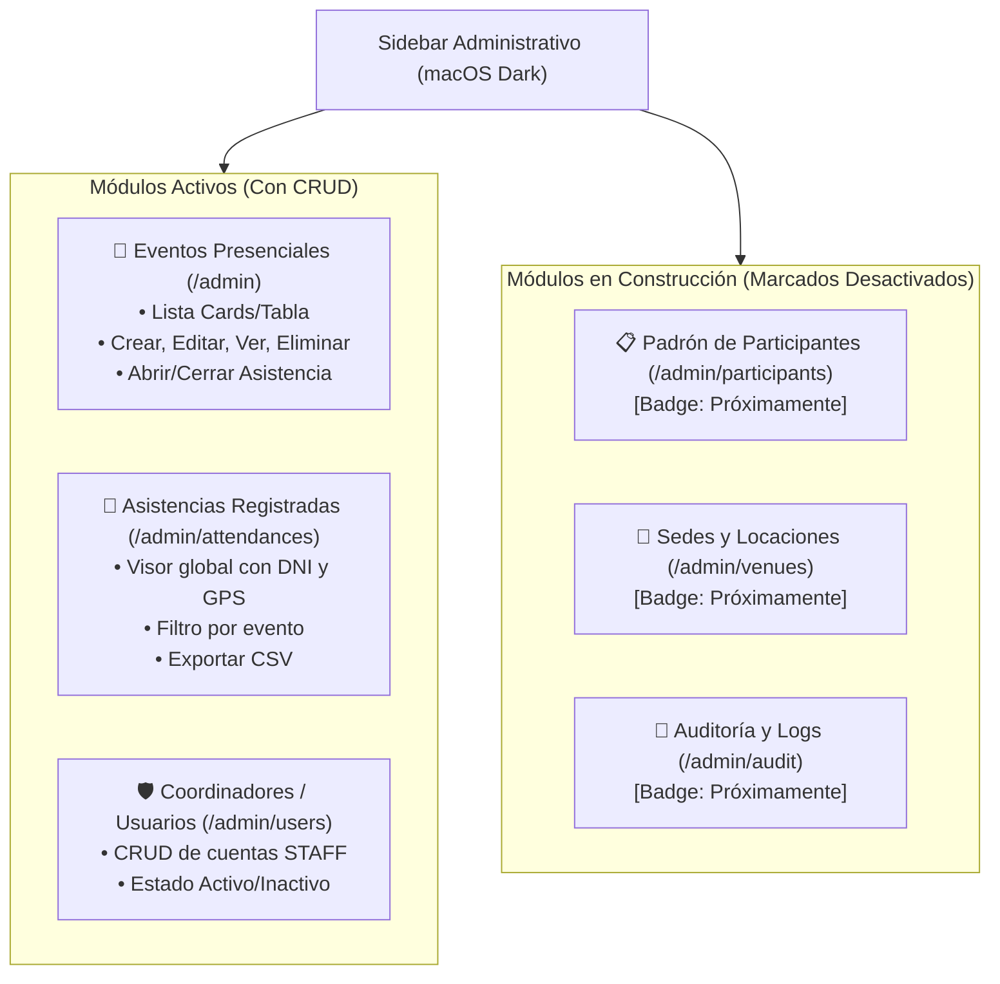

# Plan de Implementación: Módulos del Panel Administrativo, Sidebar, CRUD Completo y Vistas Cards/Tabla

## 1. Descripción del Objetivo

El usuario solicita expandir el Panel Administrativo para convertirlo en una consola de gestión completa:
1. **Navegación por Sidebar (Barra Lateral)**:
   - Diseño macOS Dark minimalista en el lateral izquierdo.
   - Módulos activos con acceso directo.
   - Módulos futuros marcados visualmente como **desactivados / "Próximamente"** (`opacity-40 pointer-events-none`).
2. **Visualización Dual (Cards vs Tabla)**:
   - Selector interactivo en el dashboard para alternar entre la vista moderna de **Tarjetas (Cards)** y una **Tabla compacta de datos (Table)**.
3. **CRUD Completo de Eventos**:
   - **Crear**: Formulario existente con autocaptura GPS.
   - **Leer / Detalle**: Nueva vista de detalle de evento con listado de asistentes, métricas y exportación.
   - **Actualizar (Editar)**: Formulario de edición para modificar título, sede, coordenadas, radio y horarios.
   - **Eliminar**: Eliminación segura con confirmación.
   - **Conmutar**: Abrir/Cerrar asistencia en un clic.
4. **Módulo de Gestión de Coordinadores / Usuarios (`/admin/users`)**:
   - Listar coordinadores registrados.
   - Crear nuevo coordinador ingresando DNI (8 dígitos), Nombre y Contraseña inicial.
   - Conmutar estado Activo / Inactivo.
   - Eliminar usuario.
5. **Módulo de Registro Global de Asistencias (`/admin/attendances`)**:
   - Vista centralizada de todas las asistencias registradas a nivel global con filtro por evento o DNI.

---

## 2. Mapa de Módulos en el Sidebar



---

## 3. Arquitectura y Componentes a Implementar

### A. Capa de Servicios (`src/services/`)
- **`src/services/event.service.ts`**:
  - `update(id: number, data: UpdateEventInput): Event`
  - `delete(id: number): boolean`
  - `getWithAttendances(id: number): { event: Event; attendances: Attendance[] }`
- **`src/services/user.service.ts`** [NEW]:
  - `getAll(): User[]`
  - `create(data: CreateUserInput): User`
  - `toggleStatus(id: number): { user: User; newStatus: "ACTIVE" | "INACTIVE" }`
  - `delete(id: number): boolean`
- **`src/services/attendance.service.ts`**:
  - `getAllWithDetails(): AttendanceWithDetails[]`
  - `delete(id: number): boolean`

---

### B. Capa de Controladores (`src/controllers/`)
- **`src/controllers/events.controller.tsx`**:
  - `index`: Soporte para selector de vista (`?view=cards` o `?view=table`).
  - `renderCreate`: Formulario de creación.
  - `create`: Procesar creación.
  - `renderEdit`: Formulario de edición con valores precargados (`GET /admin/events/:id/edit`).
  - `update`: Procesar actualización (`POST /admin/events/:id/edit`).
  - `show`: Detalle de evento con asistentes (`GET /admin/events/:id`).
  - `delete`: Procesar eliminación (`POST /admin/events/:id/delete`).
  - `toggle`: Abrir o cerrar asistencia.
- **`src/controllers/users.controller.tsx`** [NEW]:
  - `index`: Listado de usuarios coordinadores y modal para crear.
  - `create`: Crear nuevo coordinador (DNI, Nombre, Rol, Contraseña).
  - `toggle`: Desactivar/Activar coordinador.
  - `delete`: Eliminar coordinador.
- **`src/controllers/attendances_admin.controller.tsx`** [NEW]:
  - `index`: Listado de asistencias con filtro por evento y búsqueda por DNI.

---

### C. Capa de Rutas (`src/routes/admin/`)
- **`src/routes/admin/events.ts`**:
  ```typescript
  adminEventsRoute.get("/", EventsController.index);
  adminEventsRoute.get("/events/new", EventsController.renderCreate);
  adminEventsRoute.post("/events", requireAdmin, EventsController.create);
  adminEventsRoute.get("/events/:id", EventsController.show);
  adminEventsRoute.get("/events/:id/edit", requireAdmin, EventsController.renderEdit);
  adminEventsRoute.post("/events/:id/edit", requireAdmin, EventsController.update);
  adminEventsRoute.post("/events/:id/delete", requireAdmin, EventsController.delete);
  adminEventsRoute.post("/events/:id/toggle", requireAdmin, EventsController.toggle);
  ```
- **`src/routes/admin/users.ts`** [NEW]:
  ```typescript
  adminUsersRoute.get("/users", requireAdmin, UsersController.index);
  adminUsersRoute.post("/users", requireAdmin, UsersController.create);
  adminUsersRoute.post("/users/:id/toggle", requireAdmin, UsersController.toggle);
  adminUsersRoute.post("/users/:id/delete", requireAdmin, UsersController.delete);
  ```
- **`src/routes/admin/attendances.ts`** [NEW]:
  ```typescript
  adminAttendancesRoute.get("/attendances", AttendancesAdminController.index);
  adminAttendancesRoute.get("/attendances/export", AttendancesAdminController.exportCsv);
  ```

---

### D. Capa de Vistas Hono JSX (`src/views/`)
1. **`src/views/layouts/admin_layout.tsx`**:
   - Reemplazar cabecera simple por **Layout con Sidebar Lateral**:
     - Sidebar izquierdo con navegación, iconos SVG limpios, badges de estado y badge de rol.
     - Sección "Módulos principales" y sección "Próximamente" (con badges grises y enlaces bloqueados).
     - Menú móvil desplegable para pantallas pequeñas.
2. **`src/views/admin/dashboard_view.tsx`**:
   - Añadir **Toggle de Vista (Cards / Table)** en la barra de herramientas.
   - Vista de Tarjetas: diseño visual con badges animados y accesos rápidos.
   - Vista de Tabla: tabla de datos compacta tipo Excel/Airtable con acciones (Ver, Editar, Estado, Eliminar).
3. **`src/views/admin/event_edit_view.tsx`** [NEW]:
   - Formulario de edición precargado con opción de actualizar coordenadas GPS, radio, título y fechas.
4. **`src/views/admin/event_detail_view.tsx`** [NEW]:
   - Información detallada del evento, coordenadas, mapa estático/enlace a Google Maps, código QR ampliado, y tabla de asistentes con DNI, distancia calculada y hora exacta.
5. **`src/views/admin/users_view.tsx`** [NEW]:
   - Tabla de coordinadores y formulario de nuevo usuario.
6. **`src/views/admin/attendances_view.tsx`** [NEW]:
   - Registro general de asistencias en tiempo real con buscador.

---

## 4. Plan de Verificación

### Pruebas Automatizadas
1. **Tests de CRUD de Eventos**:
   - Crear evento -> Editar título/sede -> Comprobar persistencia.
   - Eliminar evento -> Comprobar que ya no aparece en la base de datos ni en el listado.
   - Alternar vistas cards/tabla -> Comprobar renderizado de HTML correspondiente.
2. **Tests de CRUD de Usuarios**:
   - Crear coordinador con DNI válido -> Comprobar hash de contraseña y rol `STAFF`.
   - Conmutar estado de usuario (`ACTIVE` <-> `INACTIVE`).
   - STAFF no puede acceder a crear otros usuarios ni eliminar eventos (403 Forbidden).
3. **Ejecución de Suite**:
   ```bash
   bun check
   bun test
   ```
   Asegurar que todas las 44 pruebas actuales + las nuevas pruebas pasen con 0 fallos.
