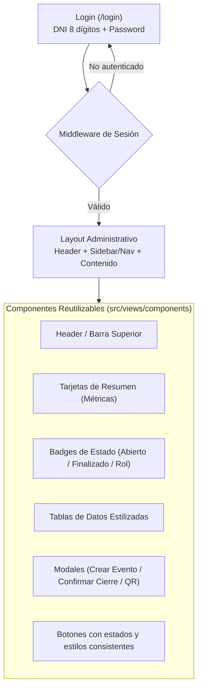

# Plan de Implementación: Panel Administrativo y Gestión de Cuentas (DNI + Contraseña)

## 1. Descripción del Objetivo
Implementar el módulo de autenticación y panel de gestión para Administradores y Coordinadores siguiendo la misma línea estética ya definida en la vista de asistencia:
- **Estética macOS Dark**: Fondo `neutral-950`, tarjetas y contenedores `neutral-900`, bordes sutiles `neutral-800/70`, contrastes `neutral-800/50`.
- **Iconografía**: Cero emojis, únicamente vectores SVG nítidos y proporcionados.
- **Tipografía**: `Inter` con jerarquía clara.
- **Acceso Exclusivo por DNI**: Autenticación mediante **DNI (8 dígitos) + Contraseña**, sin correos electrónicos.
- **Componentes Reutilizables en Servidor (SSR)**: Funciones modulares en TypeScript sin dependencias pesadas de frameworks cliente, apoyadas por Alpine.js para interactividad mínima (modales, pestañas, confirmaciones).

---

## 2. Decisiones de Autenticación y Seguridad

1. **Identificador Único**: DNI de 8 dígitos estrictos (formato numérico `/^\d{8}$/`).
2. **Hashing de Contraseñas**: Uso nativo de `Bun.password.hash` (Argon2id / Bcrypt) para verificar credenciales de manera segura.
3. **Manejo de Sesión**:
   - Cookie segura con flags `HttpOnly; SameSite=Lax; Path=/`.
   - Token de sesión criptográfico (firmado / HMAC o ID de sesión indexado) para evitar manipulación en cliente.
4. **Control de Acceso Basado en Roles (RBAC)**:
   - `ADMIN`: Gestión de usuarios (crear coordinadores), gestión de todos los eventos, reportes globales.
   - `COORDINADOR`: Gestión de sus eventos asignados, abrir/cerrar asistencia, ver lista en vivo.

---

## 3. Arquitectura de Componentes de Interfaz

---

## 4. Archivos Propuestos a Crear y Modificar

### A. Capa de Base de Datos y Autenticación
- **`src/utils/auth.ts`** [NEW]:
  - `hashPassword(password: string): Promise<string>`
  - `verifyPassword(password: string, hash: string): Promise<boolean>`
  - Creación y verificación de cookies de sesión firmadas con secreto de aplicación.
- **`src/db/seed.ts`** [MODIFY]:
  - Crear usuario administrador inicial por defecto: DNI `00000000` con contraseña hasheada para primer acceso.

### B. Rutas y Controladores
- **`src/routes/admin/auth.ts`** [NEW]:
  - `GET /login`: Formulario de acceso con DNI y contraseña.
  - `POST /login`: Validación de 8 dígitos, comparación de hash y generación de cookie.
  - `POST /logout`: Invalidación de sesión y redirección.
- **`src/routes/admin/dashboard.ts`** [NEW]:
  - `GET /admin`: Panel principal con eventos activos, métricas de asistencias del día y accesos rápidos.
- **`src/routes/admin/events.ts`** [NEW]:
  - `POST /admin/events`: Crear nuevo evento con coordenadas, radio y horarios.
  - `POST /admin/events/:id/toggle`: Abrir o cerrar asistencia en tiempo real.
- **`src/routes/admin/users.ts`** [NEW]:
  - Gestión de cuentas: crear coordinadores ingresando su DNI, nombre y contraseña inicial.

### C. Componentes y Vistas
- **`src/views/layouts/admin_layout.ts`** [NEW]:
  - Marco envolvente con cabecera (logo, nombre de usuario logueado, botón de salir).
- **`src/views/components/`** [NEW]:
  - `stat_card.ts`: Métricas con iconos SVG.
  - `event_card.ts`: Tarjeta de evento con estado en vivo, enlaces y botón de QR.
  - `modal_qr.ts`: Diálogo para mostrar código QR del evento y link para copiar.
- **`src/views/admin/login_view.ts`** [NEW]:
  - Pantalla de acceso idéntica al estilo de asistencia (tarjeta centrada macOS Dark, input DNI monoespaciado, input contraseña, botón azul).
- **`src/views/admin/dashboard_view.ts`** [NEW]:
  - Lista de eventos, botón "+ Nuevo Evento", resumen de participación.

---

## 5. Plan de Verificación

### Pruebas Automatizadas (`tests/auth_admin.test.ts`)
1. **Validación de login**:
   - DNI inválido (< 8 dígitos o caracteres alfabéticos) -> Error 400.
   - Contraseña incorrecta -> Error 401.
   - Credenciales correctas -> Cookie `Set-Cookie` presente y redirección a `/admin`.
2. **Protección de rutas**:
   - Petición a `/admin` sin cookie -> Redirección a `/login`.
   - Petición a `/admin` con sesión activa -> Status 200 con layout administrativo.
3. **Operaciones de evento**:
   - Conmutar estado de evento de `DRAFT` a `OPEN` y `CLOSED` desde el panel.

### Comprobación Manual
1. Iniciar sesión con DNI y contraseña del usuario inicial.
2. Crear un nuevo evento desde la interfaz con ubicación y horario.
3. Abrir el evento, copiar el link/QR y comprobar que la pantalla de asistencia pública lo reconozca de inmediato.
