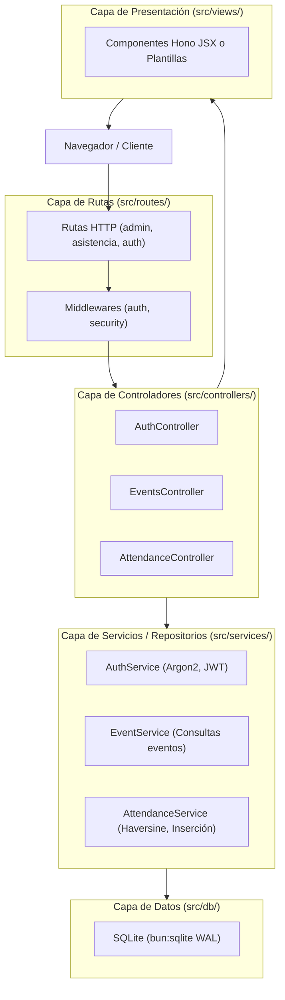

# Plan de Arquitectura: Motor de Plantillas y Separación en Capas (MVC)

## 1. Diagnóstico y Visión General

Tu apreciación es **totalmente acertada y refleja las mejores prácticas de ingeniería de software**:
1. **HTML en las rutas**: Mantener cadenas de texto HTML o templates directamente dentro de los archivos de rutas ensucia el enrutamiento y dificulta el mantenimiento, la depuración y la reutilización.
2. **Falta de separación de responsabilidades**: Mezclar en un mismo archivo la definición de rutas HTTP, la extracción de parámetros, las consultas SQL a SQLite y el renderizado genera un código acoplado y difícil de testear.

---

## 2. Decisiones Arquitectónicas

### A. Motor de Renderizado / Plantillas
Para mantener el proyecto **ultra veloz, ligero y sin React en el cliente**, existen dos opciones principales:

| Opción | Pros | Contras |
|---|---|---|
| **Hono JSX (`hono/jsx`) — Recomendada** | • **0 dependencias adicionales** (ya viene integrado en Hono).<br/>• **100% Server-Side** (genera HTML plano en el servidor, 0 KB de JS en el cliente).<br/>• Tipado estricto con TypeScript (autocompletado de variables, prevención de errores).<br/>• Componentes limpios y reutilizables (`<AdminLayout>`, `<EventCard>`, `<StatusBadge>`).<br/>• Escapado automático contra ataques XSS. | Requiere usar extensión `.tsx` en la carpeta `views/`. |
| **Eta (`.eta` / `.html`)** | • Sintaxis similar a EJS/ERB con archivos de texto `.html`.<br/>• Rápido para motores basados en cadenas. | Requiere instalar una dependencia adicional (`eta`), menor chequeo de tipos estático que JSX. |

> [!TIP]
> **Recomendación: Hono JSX (`hono/jsx`)**. Es la solución nativa diseñada específicamente para Hono en Bun. No envía librerías al navegador del cliente: Bun lo compila directamente a funciones que devuelven HTML ultrarrápido y limpio en el servidor con componentes modulares.

---

### B. Separación en Capas: MVC (Model - View - Controller)

Incluso con una base de datos local SQLite, estructurar el proyecto en capas ofrece enormes ventajas:



#### ¿Por qué es muy conveniente separar las consultas a SQLite?
1. **Control de Errores Tipados y Centralizados**:
   - En SQLite, los errores de restricción (ej. DNI duplicado en el mismo evento) arrojan excepciones de bajo nivel (`SQLITE_CONSTRAINT`).
   - La capa de Servicios captura estos errores y lanza excepciones semánticas de negocio:
     - `AttendanceDuplicateError`
     - `EventNotFoundError`
     - `EventClosedError`
     - `OutOfRadiusError`
   - El Controlador simplemente atrapa la excepción y devuelve el código de estado correspondiente (400, 404, 409), manteniendo las rutas 100% limpias.
2. **Reutilización de Consultas**:
   - Consultas frecuentes (como obtener detalles de un evento con conteo de asistentes o validar estado activo) se definen una sola vez en el servicio y se reutilizan en múltiples partes.
3. **Rutas Limpias y Legibles**:
   El archivo de rutas se convierte en un índice de 10 líneas:
   ```typescript
   export const adminEventsRoute = new Hono();
   adminEventsRoute.get("/", AdminEventsController.index);
   adminEventsRoute.get("/events/new", AdminEventsController.renderCreate);
   adminEventsRoute.post("/events", AdminEventsController.create);
   adminEventsRoute.post("/events/:id/toggle", AdminEventsController.toggle);
   ```

---

## 3. Estructura Propuesta de Carpetas

```text
src/
├── controllers/          # Lógica HTTP (recibir request, llamar servicio, responder vista)
│   ├── auth.controller.ts
│   ├── events.controller.ts
│   └── attendance.controller.ts
├── services/             # Lógica de negocio y consultas SQL a SQLite
│   ├── auth.service.ts
│   ├── event.service.ts
│   ├── attendance.service.ts
│   └── errors.ts         # Excepciones de dominio tipadas
├── routes/               # Declaración limpia de endpoints
│   ├── admin/
│   │   ├── auth.routes.ts
│   │   └── events.routes.ts
│   └── attendance.routes.ts
├── views/                # Componentes Hono JSX (.tsx)
│   ├── layouts/
│   ├── admin/
│   ├── public/
│   └── errors/
└── db/                   # Inicialización y esquemas de SQLite
```

---

## 4. Plan de Ejecución Gradual (Sin romper las 28 pruebas existentes)

1. **Fase 1: Capa de Servicios (`src/services/`)**:
   - Extraer las consultas SQL directas de las rutas hacia `EventService`, `AttendanceService` y `AuthService`.
   - Definir las excepciones de dominio en `src/services/errors.ts`.
2. **Fase 2: Capa de Controladores (`src/controllers/`)**:
   - Crear los controladores desacoplando la lógica HTTP de la definición de rutas.
3. **Fase 3: Motor de Vistas con Hono JSX**:
   - Convertir las plantillas de cadenas a componentes funcionales JSX (`.tsx`), limpios y reutilizables.
4. **Fase 4: Verificación Continua**:
   - Ejecutar `bun check` y `bun test` en cada fase asegurando que todas las pruebas pasen al 100%.
