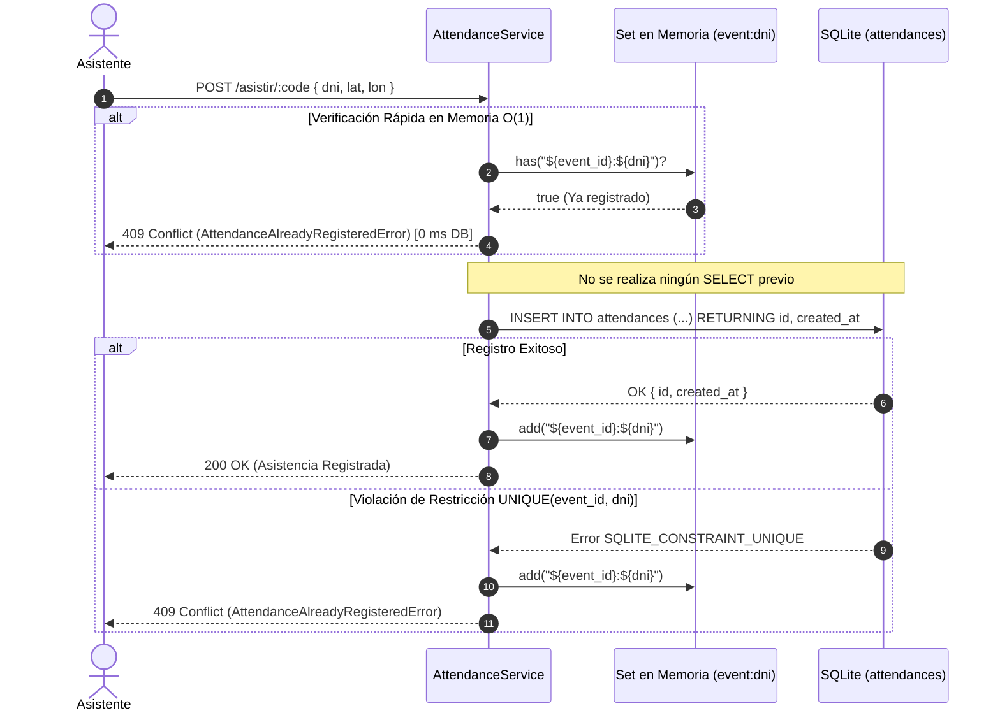

# Plan de Implementación: Optimización Atómica de Duplicados, Arquitectura de Base de Datos y Centralización de Configuración (.env)

## 1. Descripción del Objetivo

El usuario plantea tres mejoras fundamentales para la robustez, rendimiento y mantenibilidad del sistema:
1. **Eliminar la Consulta Previa de Duplicados (Optimistic Insert)**:
   - Evitar el anti-patrón *check-then-act* (`SELECT` previo a `INSERT` en cada marcación de asistencia).
   - Delegar la unicidad de forma atómica a la restricción `UNIQUE(event_id, dni)` ya existente en SQLite, capturando la violación de restricción (`SQLITE_CONSTRAINT_UNIQUE`) y complementándola con una caché en memoria O(1) para reintentos inmediatos.
2. **Clarificación y Optimización de la Conexión a Base de Datos**:
   - Explicar y documentar la arquitectura de SQLite en Bun (motor embebido in-process vs pools de red TCP).
   - Limpiar `getDatabase()`, extrayendo la configuración de PRAGMAs (`WAL`, `foreign_keys`, `busy_timeout`) a un módulo dedicado.
   - Implementar un gestor de **Prepared Statements cacheados** para evitar que SQLite recompile el bytecode SQL en cada consulta.
3. **Centralización de Variables de Entorno (`.env`) y Constantes de Negocio**:
   - Crear `.env.example` y `.env` con todas las variables configurables del sistema (`PORT`, `DATABASE_PATH`, `JWT_SECRET`, etc.).
   - Crear `src/config/env.ts` con tipado estricto y valores por defecto seguros.
   - Crear `src/config/constants.ts` con constantes del dominio (radio de la Tierra en Haversine, límites de radio de cobertura, longitud y regex de DNI, expiración de sesiones JWT, etc.).
   - Refactorizar el código fuente para eliminar valores mágicos hardcodeados.

---

## 2. Análisis Técnico Detallado

### A. Registro de Asistencias: De "Check-then-Act" a Inserción Atómica



**Beneficios Técnicos**:
1. **50% menos I/O en asistencias válidas**: Se elimina la consulta `SELECT` que antes se ejecutaba en cada marcación.
2. **Inmunidad a condiciones de carrera (Race Conditions / TOCTOU)**: Dos peticiones simultáneas para el mismo DNI ya no pasarán el filtro `SELECT`; SQLite garantizará a nivel de motor de almacenamiento que solo una se inserte.

---

### B. Arquitectura de Conexión en SQLite con Bun

En bases de datos cliente-servidor (PostgreSQL, MySQL), el *Connection Pooling* existe porque abrir un socket TCP y realizar el handshake TLS es muy costoso. 

En **Bun + SQLite**:
- SQLite **no** es un servidor externo; es una librería C compilada directamente en el binario de Bun.
- No hay sockets de red ni conexiones TCP.
- `getDatabase()` opera como un **Singleton en memoria** que mantiene abierta la base de datos para todas las rutas del event loop.
- **Modo WAL (`PRAGMA journal_mode = WAL`)**: Permite que múltiples lectores concurrentes lean la base de datos sin bloquear al escritor, y el escritor escribe sin bloquear a los lectores.
- **Preparación de Sentencias**: Para evitar que SQLite parsee y compile las sentencias SQL en cada invocación, implementaremos un diccionario de *prepared statements* cacheados.

---

### C. Estructura de Configuración y Constantes

```
src/
├── config/
│   ├── env.ts          # Variables de entorno tipadas (.env)
│   ├── constants.ts    # Constantes de negocio (DNI, GPS, radios, sesión)
│   └── index.ts
.env.example            # Plantilla documentada de variables de entorno
.env                    # Variables locales (ignorado en git)
```

#### Variables en `src/config/env.ts`
- `PORT`: Puerto HTTP (por defecto `3000`).
- `NODE_ENV`: Entorno (`development`, `production`, `test`).
- `DATABASE_PATH`: Ruta al archivo SQLite (por defecto `data.sqlite`).
- `JWT_SECRET`: Llave criptográfica para firmas HMAC de sesión.
- `SESSION_COOKIE_NAME`: Nombre de la cookie de autenticación (por defecto `auth_session`).
- `SESSION_MAX_AGE_SECONDS`: Duración de sesión (por defecto `28800` seg = 8 horas).
- `NOMINATIM_USER_AGENT`: User-Agent para consultas de OpenStreetMap.
- `AUTO_SEED`: Booleano para sembrado automático de datos demo.

#### Constantes en `src/config/constants.ts`
- `DNI_LENGTH = 8`
- `DNI_REGEX = /^\d{8}$/`
- `EARTH_RADIUS_METERS = 6_371_000` (Haversine)
- `DEFAULT_RADIUS_METERS = 100`
- `MIN_RADIUS_METERS = 10`
- `MAX_RADIUS_METERS = 5000`
- `SUPER_ADMIN_IDENTIFIER = "00000000"`
- `DEFAULT_PAGE_LIMIT = 25`
- `MAX_PAGE_LIMIT = 100`
- `MIN_PASSWORD_LENGTH = 6`
- `MIN_FULL_NAME_LENGTH = 3`
- `EVENT_CODE_PREFIX = "ev-"`

---

## 3. Plan de Cambios Detallado

### A. Nuevos Archivos de Configuración

#### [NEW] `.env.example`
- Archivo base documentado para configurar la aplicación en cualquier servidor o despliegue Dokploy.

#### [NEW] `src/config/constants.ts`
- Centralización de todas las constantes de negocio y algoritmos.

#### [NEW] `src/config/env.ts`
- Función de validación y exportación de variables de entorno con Bun.

#### [NEW] `src/config/index.ts`
- Exportación centralizada de `env` y `constants`.

---

### B. Módulo de Base de Datos (`src/db/`)

#### [MODIFY] `src/db/index.ts`
- Limpiar `getDatabase()` separando la inicialización de PRAGMAs a una función `applyPragmas(db)`.
- Usar `env.DATABASE_PATH` como fuente de la ruta.
- Implementar helper de Prepared Statements cacheados para reutilizar sentencias compiladas.

---

### C. Servicios y Controladores (`src/services/`, `src/utils/`)

#### [MODIFY] `src/services/attendance.service.ts`
- **Eliminar el `SELECT` previo de verificación de duplicados**.
- Envolver la ejecución del `INSERT INTO attendances` en un `try / catch`:
  - Detectar el error `SQLITE_CONSTRAINT_UNIQUE` o texto `UNIQUE constraint failed`.
  - Mapear directamente a `AttendanceAlreadyRegisteredError(dni)`.
- Incorporar caché en memoria `registeredDnis: Set<string>` para evitar tocar SQLite cuando un usuario insiste en marcar repetidamente.
- Usar `EARTH_RADIUS_METERS`, `DNI_REGEX` y `DEFAULT_PAGE_LIMIT` importados desde `src/config`.

#### [MODIFY] `src/services/event.service.ts`
- Usar constantes de radio (`MIN_RADIUS_METERS`, `MAX_RADIUS_METERS`, `DEFAULT_RADIUS_METERS`, `EVENT_CODE_PREFIX`) desde `src/config`.

#### [MODIFY] `src/services/user.service.ts`
- Usar `DNI_REGEX`, `SUPER_ADMIN_IDENTIFIER`, `MIN_PASSWORD_LENGTH`, `MIN_FULL_NAME_LENGTH` desde `src/config`.

#### [MODIFY] `src/utils/auth.ts`
- Reemplazar hardcodes por `env.JWT_SECRET`, `env.SESSION_COOKIE_NAME` y `env.SESSION_MAX_AGE_SECONDS`.

#### [MODIFY] `src/routes/api/geo.ts`
- Usar `env.NOMINATIM_USER_AGENT` desde `src/config`.

#### [MODIFY] `src/index.ts`
- Usar `env.PORT` y `env.NODE_ENV` desde `src/config`.

---

## 4. Plan de Verificación

### Pruebas Automatizadas
1. **Prueba de Inserción Atómica y Manejo de Duplicados**:
   - `tests/attendance.test.ts`: verificar que el registro de asistencia duplica arroje `409 Conflict` mediante la restricción de SQLite.
   - Verificar que no se ejecuten consultas `SELECT` redundantes.
2. **Pruebas de Configuración y Constantes**:
   - Crear `tests/config.test.ts` verificando que los valores por defecto y la carga de variables de entorno funcionen correctamente.
3. **Suite Completa**:
   - `bun run typecheck` (0 errores en todos los archivos).
   - `bun test` (100% de las 86 pruebas pasando).

### Verificación Manual
- Validar que al arrancar el servidor se lean las variables desde `.env` si existe.
- Validar que al intentar registrar dos veces el mismo DNI en un evento se reciba la alerta de duplicado de inmediato sin inconsistencias.
