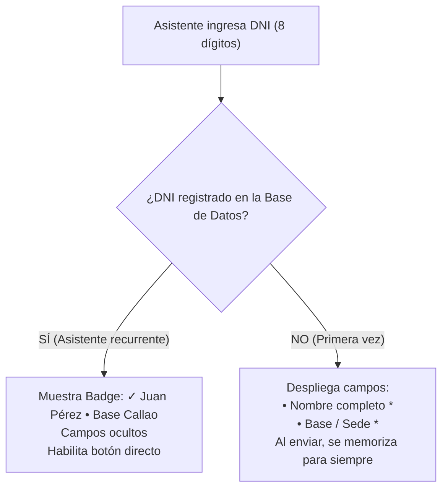
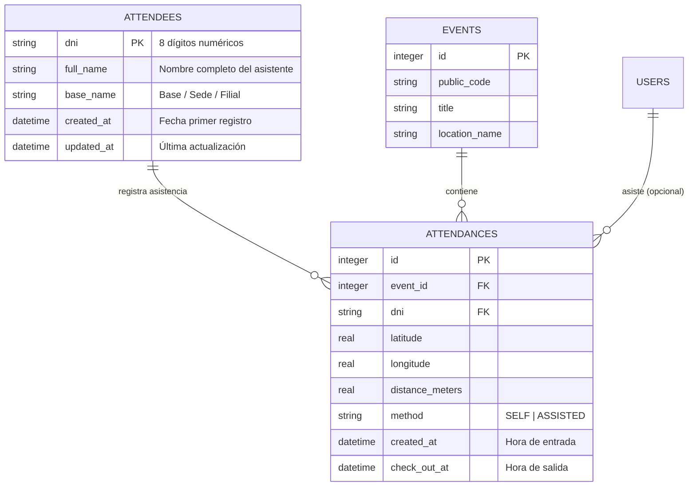

# Plan de Arquitectura: Registro Único de Nombre y Base (Padrón Inteligente por DNI)

## 1. Descripción del Problema y Objetivo

Actualmente, el sistema registra la asistencia únicamente asociando el número de **DNI (8 dígitos)** y la ubicación GPS. La organización requiere registrar el **Nombre Completo** y la **Base / Sede** del asistente, pero con una regla clave de experiencia de usuario:
- **La primera vez** que un DNI asiste a cualquier evento del sistema, se le debe solicitar su **Nombre** y su **Base**.
- **A partir de la segunda vez** (en ese mismo evento o en cualquier evento futuro), el sistema **ya lo reconoce de inmediato** y solo le pide su **DNI**, sin volver a exigirle escribir su nombre ni su base.

Este documento presenta las alternativas técnicas analizadas, la arquitectura recomendada, los cambios propuestos en base de datos, APIs y frontend, y los pasos para su implementación.

---

## 2. Alternativas Técnicas Analizadas



### Opción 1: Padrón Centralizado en Base de Datos con Verificación Instantánea (Recomendada)
- **Mecanismo:** Creamos una tabla `attendees` (padrón de asistentes) en SQLite indexada por `dni`. Cuando el usuario escribe el octavo dígito de su DNI en el celular, el navegador hace una consulta ultrarrápida (`GET /asistir/lookup/:dni`).
  - Si el DNI **ya existe**: El servidor devuelve `{ registered: true, full_name: "...", base_name: "..." }`. La pantalla le da la bienvenida con su nombre y base, y no le pide volver a ingresarlos.
  - Si el DNI **es nuevo**: El servidor devuelve `{ registered: false }`. La pantalla abre suavemente los dos campos (`Nombre completo` y `Base / Sede`) para que los complete una única vez.
- **Ventajas:**
  - **Permanencia total:** Funciona si el asistente cambia de celular, si borra cookies o si asiste a futuros eventos en otras sedes.
  - **Panel administrativo completo:** Los administradores ahora ven el nombre de la persona y su base en la lista de asistencias y en el reporte CSV de Excel, en lugar de solo DNIs numéricos.
  - **Experiencia sin fricción:** Cero recargas de página, verificación en < 20 ms.

### Opción 2: Almacenamiento solo en Cookies / LocalStorage del Celular (Descartada)
- **Problema:** Si el usuario borra la memoria del navegador, usa modo incógnito, o marca desde el celular de un compañero ("préstame tu celular para marcar"), el sistema no tendría cómo saber quién es. Además, los administradores no tendrían un padrón centralizado en el servidor.

> [!NOTE]
> Adoptamos la **Opción 1** con un complemento local en `localStorage` para que el celular del asistente recuerde su propio DNI y agilice las siguientes marcaciones.

---

## 3. Decisiones de Diseño y Preguntas para el Usuario

> [!IMPORTANT]
> **Revisión de Requisitos:**
> 1. **Nombre de los campos:** Proponemos los campos `full_name` (etiqueta: "Nombre y Apellidos") y `base_name` (etiqueta: "Base o Filial"). ¿La denominación "Base" es suficiente o prefieres un menú desplegable (select) con bases predefinidas?
> 2. **Alcance del padrón:** El registro será **global** a nivel de sistema. Es decir, si Juan se registra en el "Evento A", cuando vaya al "Evento B" la próxima semana, el "Evento B" ya sabrá automáticamente que es Juan de la Base X sin pedirle datos de nuevo.
> 3. **Exportación CSV:** Añadiremos las columnas `Nombre` y `Base` al reporte descargable de asistencias de los administradores.

---

## 4. Arquitectura de Datos y Relaciones



---

## 5. Cambios Propuestos por Componente

### Base de Datos (`src/db/`)

#### [MODIFY] [`src/db/schema.sql`](file:///home/souda/Laboratory/bandera-asistencia/src/db/schema.sql) y [`src/db/index.ts`](file:///home/souda/Laboratory/bandera-asistencia/src/db/index.ts)
- Crear la tabla `attendees`:
  ```sql
  CREATE TABLE IF NOT EXISTS attendees (
      dni TEXT PRIMARY KEY,
      full_name TEXT NOT NULL,
      base_name TEXT NOT NULL,
      created_at TEXT NOT NULL DEFAULT (strftime('%Y-%m-%dT%H:%M:%fZ', 'now')),
      updated_at TEXT NOT NULL DEFAULT (strftime('%Y-%m-%dT%H:%M:%fZ', 'now')),
      CHECK (length(dni) = 8 AND dni NOT GLOB '*[^0-9]*')
  ) STRICT;

  CREATE INDEX IF NOT EXISTS idx_attendees_base ON attendees(base_name);
  ```
- En `initSchema` de [`src/db/index.ts`](file:///home/souda/Laboratory/bandera-asistencia/src/db/index.ts), ejecutar la creación de tabla e índices para instalaciones existentes.

---

### Servicios y Lógica de Negocio (`src/services/`)

#### [NEW] [`src/services/attendee.service.ts`](file:///home/souda/Laboratory/bandera-asistencia/src/services/attendee.service.ts)
- `AttendeeService.findByDni(dni: string): Attendee | null`: Consulta rápida por clave primaria.
- `AttendeeService.upsert(dni: string, fullName: string, baseName: string): Attendee`: Guarda o actualiza los datos del asistente.

#### [MODIFY] [`src/services/attendance.service.ts`](file:///home/souda/Laboratory/bandera-asistencia/src/services/attendance.service.ts)
- Actualizar `RegisterAttendanceInput` para recibir opcionalmente `fullName?: string` y `baseName?: string`.
- Durante el registro de entrada (`CHECK_IN`), si el DNI no existe en `attendees`, exige `fullName` y `baseName` y los guarda en una transacción atómica junto a la asistencia.
- Actualizar consultas de asistencias (`getAllWithEventInfo`, `getByEventId`) con `LEFT JOIN attendees ON attendances.dni = attendees.dni` para traer el nombre y la base del asistente a los reportes.

---

### Rutas y Controladores (`src/routes/` y `src/controllers/`)

#### [NEW] Endpoint de Consulta de Padrón en [`src/routes/asistencia.ts`](file:///home/souda/Laboratory/bandera-asistencia/src/routes/asistencia.ts)
- Ruta: `GET /asistir/lookup/:dni`
- Lógica en [`src/controllers/attendance.controller.tsx`](file:///home/souda/Laboratory/bandera-asistencia/src/controllers/attendance.controller.tsx):
  - Valida que el DNI tenga 8 dígitos numéricos.
  - Consulta `AttendeeService.findByDni(dni)`.
  - Retorna JSON:
    ```json
    { "registered": true, "full_name": "Juan Pérez", "base_name": "Base San Isidro" }
    ```
    o
    ```json
    { "registered": false }
    ```

#### [MODIFY] [`src/controllers/attendances_admin.controller.tsx`](file:///home/souda/Laboratory/bandera-asistencia/src/controllers/attendances_admin.controller.tsx)
- Añadir las columnas `Nombre` y `Base` a la exportación CSV (`/admin/attendances/export`).

---

### Interfaz Pública de Asistencia (`src/views/` y `public/js/`)

#### [MODIFY] [`src/views/asistencia.tsx`](file:///home/souda/Laboratory/bandera-asistencia/src/views/asistencia.tsx)
- Añadir contenedor dinámico para asistente reconocido o campos de primera vez:
  ```tsx
  {/* Badge de Asistente Reconocido (oculto por defecto) */}
  <div id="attendeeKnownBadge" class="hidden p-3 rounded-xl bg-blue-950/40 border border-blue-800/40 flex items-center justify-between text-xs">
    <div class="flex items-center gap-2">
      <span class="w-2 h-2 rounded-full bg-emerald-400"></span>
      <span id="attendeeKnownName" class="font-semibold text-white"></span>
      <span class="text-neutral-500">&bull;</span>
      <span id="attendeeKnownBase" class="text-neutral-300"></span>
    </div>
  </div>

  {/* Campos de Primera Vez (desplegados solo si no existe en el padrón) */}
  <div id="firstTimeFields" class="hidden space-y-3.5 pt-1">
    <div class="p-3 rounded-xl bg-neutral-800/60 border border-neutral-700/60 text-xs text-neutral-300 flex items-center gap-2">
      <svg class="w-4 h-4 text-blue-400 shrink-0" fill="none" viewBox="0 0 24 24" stroke="currentColor">
        <path stroke-linecap="round" stroke-linejoin="round" d="M13 16h-1v-4h-1m1-4h.01M21 12a9 9 0 11-18 0 9 9 0 0118 0z" />
      </svg>
      <span>Primera vez: Completa tus datos para registrarte en el padrón.</span>
    </div>
    <div>
      <label for="fullNameInput" class="block text-xs font-semibold text-neutral-300 mb-1">Nombre completo *</label>
      <input type="text" id="fullNameInput" name="full_name" placeholder="Ej: Juan Pérez García" class="w-full bg-neutral-800 border border-neutral-700 rounded-xl text-white text-sm py-2.5 px-3.5 focus:outline-none focus:border-blue-500" />
    </div>
    <div>
      <label for="baseNameInput" class="block text-xs font-semibold text-neutral-300 mb-1">Base o Filial *</label>
      <input type="text" id="baseNameInput" name="base_name" placeholder="Ej: Base San Juan / Sede Central" class="w-full bg-neutral-800 border border-neutral-700 rounded-xl text-white text-sm py-2.5 px-3.5 focus:outline-none focus:border-blue-500" />
    </div>
  </div>
  ```

#### [MODIFY] [`public/js/asistencia.js`](file:///home/souda/Laboratory/bandera-asistencia/public/js/asistencia.js)
- Al escribir 8 dígitos en `#dniInput`:
  - Disparar `lookupDni(dni)`.
  - Si `registered === true`: Mostrar badge de reconocimiento con Nombre y Base, ocultar `#firstTimeFields`, y habilitar directamente el botón de envío.
  - Si `registered === false`: Mostrar `#firstTimeFields`, enfocar `#fullNameInput`, y validar que `full_name` y `base_name` no estén vacíos para habilitar el botón.
  - Al enviar la petición `POST /asistir/:code`, incluir `full_name` y `base_name` si fueron solicitados.

---

### Vistas Administrativas (`src/views/admin/`)

#### [MODIFY] [`src/views/admin/attendances_view.tsx`](file:///home/souda/Laboratory/bandera-asistencia/src/views/admin/attendances_view.tsx) y [`src/views/admin/event_detail_view.tsx`](file:///home/souda/Laboratory/bandera-asistencia/src/views/admin/event_detail_view.tsx)
- Mostrar columnas **Nombre** y **Base** en la tabla y en las tarjetas móviles para cada asistente.

---

## 6. Plan de Verificación

### Pruebas Automatizadas (`bun test`)
1. **Padrón / Lookup Test:**
   - Consultar DNI no registrado retorna `{ registered: false }`.
   - Registrar primer asistente con Nombre y Base crea el registro en `attendees`.
   - Consultar DNI ya registrado retorna `{ registered: true, full_name: "...", base_name: "..." }`.
2. **Asistencia Test:**
   - Registro de entrada de nuevo asistente exige Nombre y Base y los persiste.
   - Segunda asistencia del mismo DNI en otro evento se registra exitosamente enviando **solo DNI** (sin nombre ni base).
   - Verificación de exportación CSV conteniendo encabezados `Nombre` y `Base`.

### Verificación Manual
1. Iniciar servidor con `bun run dev`.
2. Abrir `/asistir/{codigo}` desde navegador o celular.
3. Ingresar un DNI nuevo (ej. `44556677`): observar cómo se despliegan automáticamente los campos de Nombre y Base.
4. Llenar "Pedro Alva" y "Base Centro", registrar entrada con GPS.
5. Probar con otro evento o recargar: escribir `44556677`.
6. Comprobar que aparece instantáneamente el badge `✓ Pedro Alva • Base Centro` y el botón queda habilitado directamente sin solicitar los datos.
7. Entrar al panel de administración `/admin/attendances` y verificar que Pedro Alva aparece con su Base y en el CSV exportado.
