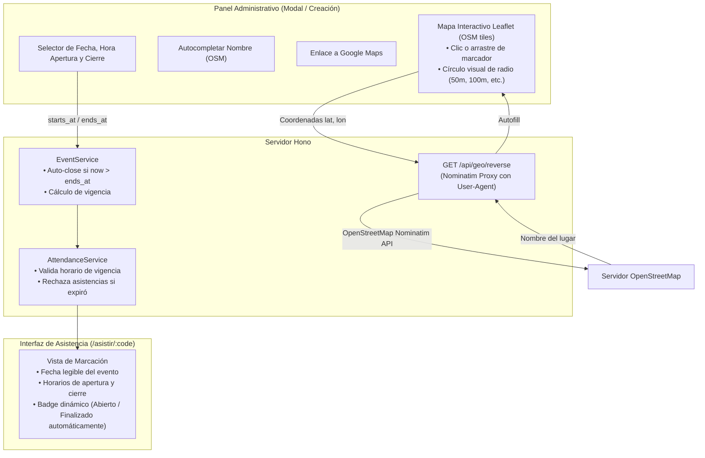

# Plan de Implementación: Cierre Automático de Eventos, Selector de Mapa Interactivo (OSM) y Geocodificación Inversa

## 1. Descripción del Objetivo

El usuario solicita tres capacidades clave para el sistema de asistencia:
1. **Cierre Automático de Eventos**:
   - Que el evento se cierre automáticamente cuando expire la fecha/hora de cierre programada.
   - Mostrar de forma clara en la interfaz de registro de asistencia (`/asistir/:code`) la **fecha del evento**, la **hora de apertura** y la **hora de cierre**, junto con el estado de vigencia en tiempo real.
2. **Selector de Mapa Interactivo en Creación de Eventos**:
   - Integrar un mapa interactivo (usando **Leaflet.js + OpenStreetMap**) donde el administrador pueda hacer clic para seleccionar un punto o arrastrar un marcador.
   - Enlace directo a Google Maps (`https://www.google.com/maps?q=lat,lon`) para verificar la ubicación en vista satelital/calle.
   - Visualización del círculo de cobertura (`radius_meters`) en tiempo real sobre el mapa.
3. **Autocompletado del Nombre del Lugar con OpenStreetMap (Nominatim)**:
   - Obtener automáticamente el nombre de la sede o dirección a partir de las coordenadas seleccionadas mediante la API de geocodificación inversa de OpenStreetMap (**Nominatim**) y rellenar el campo del formulario.
   - Implementar un proxy backend en Hono (`/api/geo/reverse`) para cumplir con las políticas de OpenStreetMap (cabecera `User-Agent` obligatoria) y evitar problemas de CORS en el navegador.
4. **Modal de Creación y Ejecución Aislada en Subagente / Worktree**:
   - Incluir soporte para el modal de creación rápida directamente en el Dashboard.
   - Ejecutar la implementación en un subagente dedicado con espacio de trabajo ramificado (**Git Worktree / branch**) para garantizar aislamiento e integridad.

---

## 2. Diagrama de Arquitectura y Flujo



---

## 3. Plan de Cambios Detallado

### A. Capa de Servicios y Lógica de Negocio (`src/services/`)

#### [MODIFY] `src/services/event.service.ts`
- Implementar función de detección de expiración:
  ```typescript
  export function isEventExpired(event: Event): boolean
  ```
  - Si `ends_at` contiene fecha y hora (formato ISO o datetime): compara con la fecha y hora actual del servidor.
  - Si `ends_at` es una hora simple (ej: `18:00` o `06:00 PM`), se combina con la fecha de inicio del evento o la fecha de creación para evaluar la expiración.
- Implementar `checkAutoClose(event: Event): Event`:
  - Si el evento está en estado `OPEN` pero ha expirado según su `ends_at`, ejecuta en la base de datos:
    `UPDATE events SET status = 'CLOSED', closed_at = $now WHERE id = $id`
    y retorna el objeto con `status = 'CLOSED'`.
- Actualizar `getByPublicCode()`, `getById()` y `getAllWithStats()` para ejecutar `checkAutoClose()` automáticamente (lazy auto-closing).

#### [MODIFY] `src/services/attendance.service.ts`
- En `register()`:
  - Verificar `isEventExpired(event)` antes de registrar la asistencia.
  - Si ha expirado, invocar `EventService.checkAutoClose(event)` y lanzar `EventClosedError("El evento ha concluido y el registro se ha cerrado automáticamente.")`.

---

### B. Proxy de Geocodificación Inversa OpenStreetMap (`src/routes/api/geo.ts`)

#### [NEW] `src/routes/api/geo.ts`
- Endpoint: `GET /api/geo/reverse?lat=:lat&lon=:lon`
- Consulta a Nominatim: `https://nominatim.openstreetmap.org/reverse?format=json&lat=${lat}&lon=${lon}&zoom=18&addressdetails=1`
- Añade cabecera requerida por la política de OSM: `User-Agent: BanderaAsistencia/1.0 (asistencia@bandera.pe)`.
- Extrae y formatea el nombre del lugar más amigable:
  - Edificio, plaza, colegio, auditorio, calle y distrito (`amenity`, `building`, `road`, `suburb`, `city`).
- Retorna JSON: `{ success: true, name: "...", display_name: "..." }`.

---

### C. Capa de Vistas (`src/views/`)

#### [MODIFY] `src/views/asistencia.tsx`
- En la tarjeta principal del evento:
  - **Fecha del Evento**: Icono SVG de calendario + fecha legible en español (ej: *"Jueves, 29 de Octubre de 2026"*).
  - **Horas de Apertura y Cierre**:
    - Apertura: Icono SVG reloj + hora (ej: *"08:30 AM"*).
    - Cierre: Icono SVG reloj/bandera + hora (ej: *"06:00 PM"*).
  - **Badge de Estado**:
    - Si el evento se cerró automáticamente por horario: Badge *"Finalizado automáticamente por horario"* con texto explicativo.
    - Si está abierto: Badge animado *"Abierto para registro hasta las HH:mm"*.

#### [MODIFY] `src/views/admin/event_form_view.tsx` & `src/views/admin/event_edit_view.tsx`
- **Selector de Mapa Interactivo Leaflet**:
  - Contenedor `#eventMap` (altura 300px, estilo macOS Dark).
  - Marcador arrastrable (`draggable: true`).
  - Círculo de cobertura semitransparente que se actualiza al cambiar el valor del radio (50m, 100m, 200m, etc.).
  - Botón *"Usar mi ubicación actual"* que centra el mapa y mueve el marcador.
  - Enlace dinámico *"Ver en Google Maps"* (`https://www.google.com/maps?q=${lat},${lon}`).
- **Geocodificación Automática Nominatim**:
  - Al hacer clic o soltar el marcador en el mapa, llama a `/api/geo/reverse?lat=...&lon=...` y rellena automáticamente el campo `location_name`.
  - Botón manual *"Consultar nombre en OpenStreetMap"* al lado del campo de sede.
- **Selectores de Fecha y Horarios**:
  - Fecha del evento (`<input type="date">` o `<input type="datetime-local">`).
  - Hora de inicio y hora de cierre con formato claro.

#### [MODIFY] `src/views/admin/dashboard_view.tsx`
- Integrar un modal desplegable *"Nuevo Evento"* con el mapa interactivo incorporado para que el administrador pueda crear eventos sin abandonar la pantalla del dashboard.

---

### D. Rutas y Controladores (`src/controllers/`, `src/routes/`)

#### [MODIFY] `src/index.ts`
- Montar `geoRoute` en `/api/geo`.

#### [MODIFY] `src/controllers/attendance.controller.tsx`
- En `status` y `renderForm`:
  - Retornar y renderizar los datos estructurados de fecha, hora de apertura, hora de cierre y si cerró automáticamente.

---

## 4. Plan de Ejecución con Subagente y Worktree

1. **Aprobación del Plan**: El usuario revisa y aprueba esta propuesta.
2. **Lanzamiento de Subagente con Worktree**:
   - Crear un subagente especializado con `Workspace: 'branch'` para trabajar en una rama aislada (`feat-auto-close-osm-map`).
   - El subagente implementa los cambios en `src/services/`, `src/routes/api/`, `src/views/` y los tests.
3. **Verificación Automatizada en el Worktree**:
   - `bun run typecheck` (0 errores).
   - `bun test` (todos los 61 tests existentes + nuevos tests de auto-close y geocoding pasando al 100%).
4. **Fusión (Merge) a `main`**:
   - Traer los cambios confirmados a la rama principal.
   - Ejecutar verificación final y reportar walkthrough al usuario.

---

## 5. Plan de Verificación

### Pruebas Automatizadas (`tests/auto_close_map.test.ts`)
- **Auto-cierre**:
  - Crear evento con `ends_at` en el pasado -> Comprobar que `EventService.checkAutoClose` lo marca `CLOSED`.
  - Intentar registrar asistencia en un evento vencido -> Comprobar que se rechaza con error 400 y mensaje de evento finalizado automáticamente.
  - Comprobar que `/asistir/:code/status` reporta `status: "CLOSED"` y `is_open: false`.
- **Geocodificación OSM**:
  - Probar que `/api/geo/reverse` maneja coordenadas válidas e inválidas correctamente.
- **Renderizado de Interfaz**:
  - Comprobar que `/asistir/:code` contiene la fecha del evento, hora de inicio y hora de fin.

### Pruebas Manuales
1. Entrar a `/admin/events/new` o abrir el modal de nuevo evento:
   - Visualizar el mapa Leaflet.
   - Hacer clic en un punto de la ciudad: verificar que el marcador se traslada, se actualizan las coordenadas y se rellena el nombre del lugar vía OpenStreetMap.
   - Cambiar el radio a 200m y observar el redimensionamiento del círculo.
   - Hacer clic en "Ver en Google Maps" y comprobar que abre las mismas coordenadas.
2. Crear un evento con hora de cierre 1 minuto en el futuro:
   - Entrar a `/asistir/:code`: verificar fecha y horas de apertura/cierre.
   - Esperar a que pase el minuto y recargar: comprobar que cambia automáticamente a "Finalizado".
