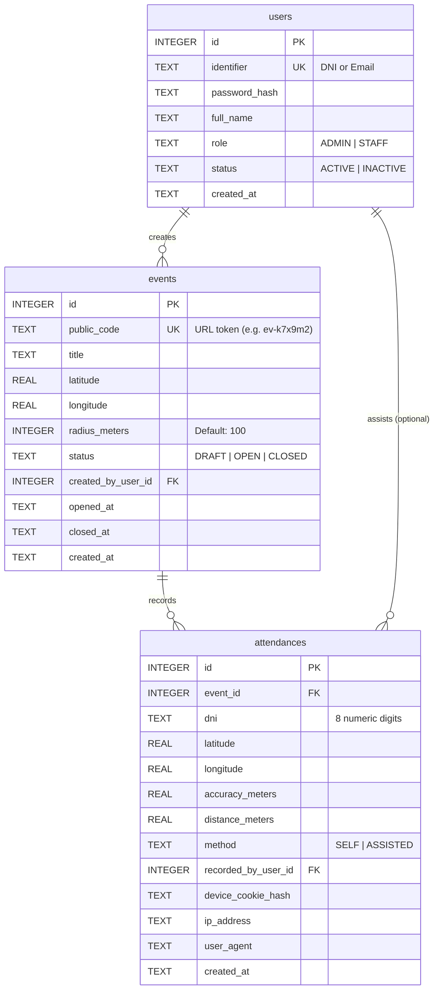
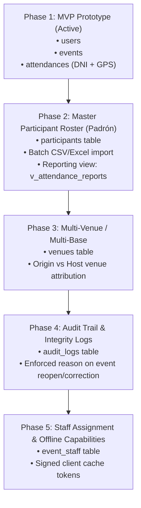

# Database Architecture & Expansion Plan

## 1. Naming Conventions & Design Standards

The database follows PostgreSQL / SQLite industry standard naming conventions:
- **Table names**: Lowercase plural in English (`users`, `events`, `attendances`, `participants`, `venues`).
- **Column names**: Lowercase `snake_case` in English (`event_id`, `public_code`, `created_at`).
- **Primary keys**: `id INTEGER PRIMARY KEY AUTOINCREMENT`.
- **Foreign keys**: `<singular_table>_id` (e.g., `event_id`, `created_by_user_id`).
- **Geographic coordinates & metrics**: `latitude`, `longitude`, `radius_meters`, `accuracy_meters`, `distance_meters`.
- **Status / Enum fields**: `status`, `method`, `role` guarded with strict `CHECK (field IN (...))` constraints.
- **Timestamps**: ISO-8601 UTC strings (`created_at`, `updated_at`, `opened_at`, `closed_at`).
- **Strict Typing**: SQLite `STRICT` mode enabled on all tables to enforce strict data types.
- **Engine Pragmas**:
  - `PRAGMA foreign_keys = ON;`
  - `PRAGMA journal_mode = WAL;`
  - `PRAGMA synchronous = NORMAL;`
  - `PRAGMA busy_timeout = 5000;`

---

## 2. Phase 1: MVP Prototype Schema (Active)

The prototype focuses exclusively on the critical flow:
1. Administrator creates and manages events with geolocation (`latitude`, `longitude`, `radius_meters`).
2. Participants access via link/QR and submit their 8-digit **DNI** + **browser geolocation**.
3. Database strictly validates DNI format, event status (`OPEN`), coordinate boundaries, and prevents duplicate entries (`UNIQUE(event_id, dni)`).



### Active SQL DDL (Prototype)

```sql
-- Engine configuration
PRAGMA foreign_keys = ON;
PRAGMA journal_mode = WAL;
PRAGMA synchronous = NORMAL;
PRAGMA busy_timeout = 5000;

-- 1. Users table
CREATE TABLE users (
    id INTEGER PRIMARY KEY AUTOINCREMENT,
    identifier TEXT NOT NULL UNIQUE,
    password_hash TEXT NOT NULL,
    full_name TEXT NOT NULL,
    role TEXT NOT NULL DEFAULT 'STAFF' CHECK (role IN ('ADMIN', 'STAFF')),
    status TEXT NOT NULL DEFAULT 'ACTIVE' CHECK (status IN ('ACTIVE', 'INACTIVE')),
    created_at TEXT NOT NULL DEFAULT (strftime('%Y-%m-%dT%H:%M:%fZ', 'now'))
) STRICT;

-- 2. Events table
CREATE TABLE events (
    id INTEGER PRIMARY KEY AUTOINCREMENT,
    public_code TEXT NOT NULL UNIQUE,
    title TEXT NOT NULL,
    latitude REAL NOT NULL,
    longitude REAL NOT NULL,
    radius_meters INTEGER NOT NULL DEFAULT 100 CHECK (radius_meters >= 10 AND radius_meters <= 5000),
    status TEXT NOT NULL DEFAULT 'DRAFT' CHECK (status IN ('DRAFT', 'OPEN', 'CLOSED')),
    created_by_user_id INTEGER REFERENCES users(id) ON DELETE SET NULL,
    opened_at TEXT,
    closed_at TEXT,
    created_at TEXT NOT NULL DEFAULT (strftime('%Y-%m-%dT%H:%M:%fZ', 'now')),

    CHECK (latitude >= -90.0 AND latitude <= 90.0),
    CHECK (longitude >= -180.0 AND longitude <= 180.0)
) STRICT;

CREATE INDEX idx_events_public_code ON events(public_code);

-- 3. Attendances table (Prototype: Pure DNI + Location)
CREATE TABLE attendances (
    id INTEGER PRIMARY KEY AUTOINCREMENT,
    event_id INTEGER NOT NULL REFERENCES events(id) ON DELETE RESTRICT,
    dni TEXT NOT NULL,
    latitude REAL NOT NULL,
    longitude REAL NOT NULL,
    accuracy_meters REAL NOT NULL,
    distance_meters REAL NOT NULL,
    method TEXT NOT NULL DEFAULT 'SELF' CHECK (method IN ('SELF', 'ASSISTED')),
    recorded_by_user_id INTEGER REFERENCES users(id) ON DELETE SET NULL,
    device_cookie_hash TEXT,
    ip_address TEXT,
    user_agent TEXT,
    created_at TEXT NOT NULL DEFAULT (strftime('%Y-%m-%dT%H:%M:%fZ', 'now')),

    -- INTEGRITY CONSTRAINTS
    UNIQUE (event_id, dni), -- Exactly 1 attendance per DNI per event
    CHECK (length(dni) = 8 AND dni NOT GLOB '*[^0-9]*'), -- Strict 8-digit DNI
    CHECK (latitude >= -90.0 AND latitude <= 90.0),
    CHECK (longitude >= -180.0 AND longitude <= 180.0),
    CHECK (accuracy_meters >= 0),
    CHECK (distance_meters >= 0),
    CHECK (method != 'ASSISTED' OR recorded_by_user_id IS NOT NULL)
) STRICT;

CREATE INDEX idx_attendances_event_dni ON attendances(event_id, dni);
CREATE INDEX idx_attendances_dni ON attendances(dni);

-- 4. Trigger: Prevent attendance if event is not OPEN
CREATE TRIGGER trg_block_attendance_when_not_open
BEFORE INSERT ON attendances
FOR EACH ROW
WHEN (SELECT status FROM events WHERE id = NEW.event_id) != 'OPEN'
BEGIN
    SELECT RAISE(ABORT, 'Rejected: Event is not open for attendance registration.');
END;
```

---

## 3. Roadmap: Expansion Plan



### Phase 2: Participants Roster (`participants`) & Cross-Referencing
When official participant records become available (CSV/Excel), this table is introduced without altering the existing `attendances` table:

```sql
CREATE TABLE participants (
    id INTEGER PRIMARY KEY AUTOINCREMENT,
    dni TEXT NOT NULL UNIQUE,
    first_name TEXT NOT NULL,
    last_name TEXT NOT NULL,
    phone TEXT,
    email TEXT,
    venue_id INTEGER, -- FK added in Phase 3
    is_dni_pending INTEGER NOT NULL DEFAULT 0 CHECK (is_dni_pending IN (0, 1)),
    created_at TEXT NOT NULL DEFAULT (strftime('%Y-%m-%dT%H:%M:%fZ', 'now')),

    CHECK (length(dni) = 8 AND dni NOT GLOB '*[^0-9]*')
) STRICT;

CREATE INDEX idx_participants_dni ON participants(dni);

-- Seamless cross-referencing view
CREATE VIEW v_attendance_reports AS
SELECT 
    a.id AS attendance_id,
    a.event_id,
    e.title AS event_title,
    a.dni,
    COALESCE(p.first_name, 'Unregistered') AS first_name,
    COALESCE(p.last_name, 'Unregistered') AS last_name,
    p.phone,
    a.created_at AS attended_at,
    a.distance_meters,
    a.accuracy_meters,
    a.method,
    u.full_name AS assisted_by
FROM attendances a
JOIN events e ON a.event_id = e.id
LEFT JOIN participants p ON a.dni = p.dni
LEFT JOIN users u ON a.recorded_by_user_id = u.id;
```

### Phase 3: Venues / Bases (`venues`)
Introduces physical sites/branches (host venue and participant origin venue):
```sql
CREATE TABLE venues (
    id INTEGER PRIMARY KEY AUTOINCREMENT,
    name TEXT NOT NULL UNIQUE COLLATE NOCASE,
    address TEXT NOT NULL DEFAULT '',
    latitude REAL,
    longitude REAL,
    manager_name TEXT NOT NULL DEFAULT '',
    contact_phone TEXT,
    status TEXT NOT NULL DEFAULT 'ACTIVE' CHECK (status IN ('ACTIVE', 'INACTIVE')),
    created_at TEXT NOT NULL DEFAULT (strftime('%Y-%m-%dT%H:%M:%fZ', 'now'))
) STRICT;

-- Non-destructive migration to link events & participants:
-- ALTER TABLE events ADD COLUMN host_venue_id INTEGER REFERENCES venues(id) ON DELETE SET NULL;
-- ALTER TABLE participants ADD COLUMN origin_venue_id INTEGER REFERENCES venues(id) ON DELETE SET NULL;
```

### Phase 4: Audit & Regulatory Trail (`audit_logs`)
Enforces mandatory audit justification whenever an event is reopened, closed, or manually corrected:
```sql
CREATE TABLE audit_logs (
    id INTEGER PRIMARY KEY AUTOINCREMENT,
    event_id INTEGER NOT NULL REFERENCES events(id) ON DELETE RESTRICT,
    user_id INTEGER NOT NULL REFERENCES users(id) ON DELETE RESTRICT,
    action TEXT NOT NULL CHECK (action IN ('OPEN', 'CLOSE', 'REOPEN', 'CORRECTION', 'REVOCATION')),
    reason TEXT NOT NULL CHECK (length(trim(reason)) >= 5),
    details_json TEXT,
    ip_address TEXT,
    created_at TEXT NOT NULL DEFAULT (strftime('%Y-%m-%dT%H:%M:%fZ', 'now'))
) STRICT;
```

### Phase 5: Staff Event Assignments (`event_staff`)
Allows assigning specific coordinators and door checkers per event:
```sql
CREATE TABLE event_staff (
    id INTEGER PRIMARY KEY AUTOINCREMENT,
    event_id INTEGER NOT NULL REFERENCES events(id) ON DELETE CASCADE,
    user_id INTEGER NOT NULL REFERENCES users(id) ON DELETE CASCADE,
    assigned_at TEXT NOT NULL DEFAULT (strftime('%Y-%m-%dT%H:%M:%fZ', 'now')),
    UNIQUE (event_id, user_id)
) STRICT;
```
