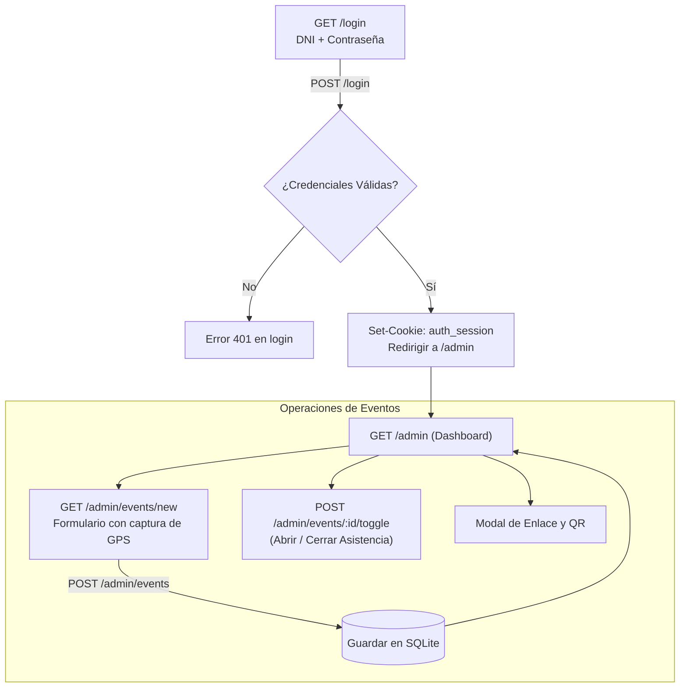

# Plan de Implementación: Módulo de Login y Creación de Eventos

## 1. Descripción del Objetivo
Focalizar y pulir la experiencia de **Autenticación (Login por DNI + Contraseña)** y el flujo de **Creación y Control de Eventos**, manteniendo de manera estricta:
- **Estética macOS Dark**: Fondo `neutral-950`, tarjetas `neutral-900`, inputs `neutral-800`, botones en azul vibrante `bg-blue-600 hover:bg-blue-500`.
- **Cero emojis**: Uso exclusivo de iconos SVG proporcionados y limpios.
- **Identificación directa por DNI**: Sin pedir correos electrónicos; DNI estricto de 8 dígitos numéricos.
- **Componentes reutilizables SSR en TypeScript**: Sin frameworks pesados en cliente.

---

## 2. Decisiones de Diseño y Flujo

### A. Módulo de Login (`/login`)
1. **Formulario**:
   - Campo **DNI**: Entrada monoespaciada con filtro numérico en tiempo real (máx. 8 dígitos).
   - Campo **Contraseña**: Entrada segura con botón para alternar visibilidad (icono de ojo SVG).
   - Botón **Iniciar Sesión**: Con estado de carga animado.
2. **Seguridad**:
   - Verificación de contraseña mediante `Bun.password.verify` (Argon2id).
   - Sesión emitida en cookie segura `auth_session` con flags `HttpOnly; SameSite=Lax; Path=/`.
   - Token JWT firmado con `hono/jwt` que expira en 24 horas.
   - Si no hay sesión válida, cualquier acceso a `/admin/*` se redirige a `/login`.
3. **Usuario Administrador Inicial (Seed)**:
   - DNI: `00000000`
   - Contraseña inicial: `admin123` (con advertencia de cambio recomendada).
   - Nombre: `Administrador Principal`

### B. Módulo de Creación y Control de Eventos (`/admin/events`)
1. **Formulario de Creación de Evento** (Modal o página integrada `/admin/events/new`):
   - **Título del Evento**: Nombre claro del evento.
   - **Nombre de Ubicación / Sede**: Ej. *"Auditorio Central - Campus Lima"*.
   - **Geolocalización (Latitud y Longitud)**:
     - Campos manuales para coordenadas numéricas.
     - Botón auxiliar **«Usar mi ubicación actual»**: Captura las coordenadas del coordinador mediante el sensor del navegador en 1 clic.
   - **Radio de Cobertura (metros)**: Selector de radio (50m, 100m, 150m, 200m o valor numérico personalizado, default 100m).
   - **Horario**: Hora de inicio y hora de fin (ej. `08:30 AM` a `06:00 PM`).
   - **Código Público del Evento**: Auto-generado de forma segura (ej. `ev-k7x9m2`).
2. **Acciones Rápidas en la Lista de Eventos**:
   - **Interruptor de Estado**: Botón para cambiar entre `Abrir asistencia` y `Cerrar asistencia` con confirmación inmediata.
   - **Ver Enlace y QR**: Modal para ver el código QR en pantalla completa y botón para copiar el enlace directo `/asistir/[codigo]`.
   - **Métricas rápidas**: Contador de asistencias registradas en tiempo real.

---

## 3. Arquitectura y Componentes Propuestos

---

## 4. Archivos a Crear y Modificar

### Componentes y Rutas
1. **`src/utils/auth.ts`** [NEW]:
   - Funciones para hashing/verificación con `Bun.password`.
   - Creación y verificación de tokens de sesión (`signToken`, `verifyToken`).
   - Middleware de protección `authMiddleware` para rutas de `/admin`.
2. **`src/routes/admin/auth.ts`** [NEW]:
   - Endpoints `GET /login`, `POST /login`, `POST /logout`.
3. **`src/routes/admin/events.ts`** [NEW]:
   - Endpoints `GET /admin`, `GET /admin/events/new`, `POST /admin/events`, `POST /admin/events/:id/toggle`.
4. **`src/views/admin/login_view.ts`** [NEW]:
   - Interfaz macOS Dark del login con DNI y contraseña, consistente con `/asistir/:code`.
5. **`src/views/admin/dashboard_view.ts`** [NEW]:
   - Vista principal con la lista de eventos, badges de estado y botón "+ Nuevo Evento".
6. **`src/views/admin/event_form_view.ts`** [NEW]:
   - Formulario de creación con botón de captura automática de coordenadas y selector de radio.
7. **`src/views/layouts/admin_layout.ts`** [NEW]:
   - Layout base del administrador: barra superior con usuario logueado, botón de salir y contenedor central.
8. **`src/db/seed.ts`** [MODIFY]:
   - Crear el usuario `00000000` con hash seguro si no existe en la base de datos.
9. **`src/index.ts`** [MODIFY]:
   - Montar las rutas administrativas `/login` y `/admin`.

---

## 5. Plan de Verificación

### Pruebas Automatizadas (`tests/admin_flow.test.ts`)
- **Login**:
  - DNI inválido (< 8 dígitos) -> 400 Bad Request.
  - Contraseña errónea -> 401 Unauthorized.
  - Credenciales de administrador válidas -> 302 Redirect con cookie `auth_session`.
- **Protección de rutas**:
  - Intento de acceder a `/admin` sin sesión -> Redirección inmediata a `/login`.
  - Acceso a `/admin` con cookie válida -> 200 OK.
- **Creación de eventos**:
  - `POST /admin/events` con datos válidos -> Crea el evento en la BD y genera código público único.
  - `POST /admin/events/:id/toggle` -> Conmuta el estado de `DRAFT` o `CLOSED` a `OPEN` y viceversa.
  - Verificar que el evento recién abierto permita registrar asistencia en `/asistir/:code`.

### Verificación Manual
1. Abrir `/login` en el navegador y probar inicio de sesión con DNI `00000000` y `admin123`.
2. Pulsar "+ Nuevo Evento", presionar "Usar mi ubicación actual" para rellenar lat/lon y guardar el evento.
3. Abrir la asistencia del evento y acceder desde otra pestaña para validar el registro.
