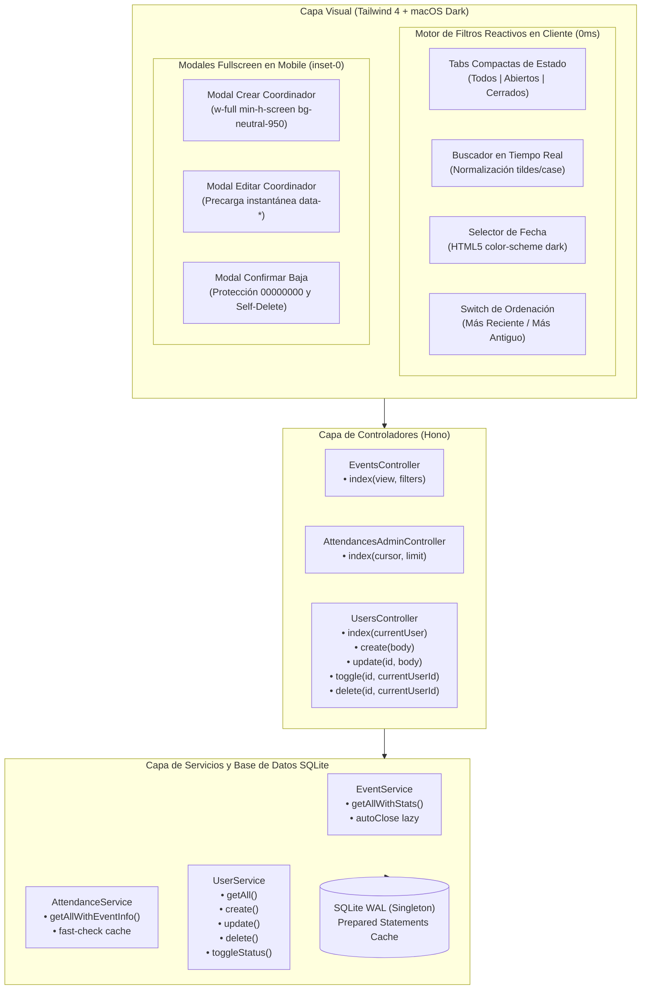
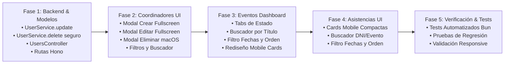

# Plan de Implementación: Optimización de Tablas Mobile, Buscadores y Filtros Reactivos, y CRUD Integral de Coordinadores

## 1. Resumen Ejecutivo y Objetivos

Este documento establece el diseño técnico y el plan de ejecución detallado para transformar la experiencia de administración del sistema **Bandera Asistencia** en dispositivos móviles y de escritorio. El objetivo primordial es resolver las limitaciones actuales de usabilidad en pantallas compactas mediante:

1. **Buscadores y Filtros Interactivos Unificados (Zero-Latency Client-Side Engine)** en las tres vistas clave del panel:
   - **Eventos** (`/admin`): Tabs compactas de estado (*Todos*, *Abiertos*, *Cerrados*), buscador en tiempo real por título, filtro por selector de fecha y ordenación por fecha de creación (*Más reciente* vs *Más antiguo*).
   - **Asistencias** (`/admin/attendances`): Cards móviles ultra-compactas con información esencial, buscador multi-criterio (DNI y nombre de evento), selector de fechas y orden por fecha de marcación.
   - **Personal de Gestión / Coordinadores** (`/admin/users`): Buscador por nombre y DNI, selector de roles (*Todos*, *ADMIN*, *STAFF*), filtro por fecha de registro y orden de creación.
2. **CRUD Completo y Seguro de Coordinadores / Personal de Gestión**:
   - **Creación**: Reemplazo del formulario inline por un modal interactivo a **pantalla completa en mobile** (`fixed inset-0 w-full min-h-screen bg-neutral-950 p-4 rounded-none`) y flotante centrado en desktop.
   - **Edición**: Incorporación del flujo completo de edición (backend `POST /admin/users/:id/edit`, método de servicio `UserService.update`, y modal fullscreen en mobile para actualizar nombre, rol y contraseña opcional).
   - **Eliminación y Toggle Protegidos**: Reemplazo de los diálogos nativos del navegador (`window.confirm`) por un modal elegante estilo macOS Dark, con salvaguardas inviolables que impiden la auto-eliminación o auto-desactivación del usuario logueado en sesión y del Administrador Principal (`00000000`).
3. **Ergonomía Mobile, Centrado y Estética macOS Dark**:
   - Supresión absoluta de emojis, reemplazándolos por iconografía SVG minimalista y nítida.
   - Eliminación de textos verbosos o redundantes en mobile, priorizando íconos con áreas táctiles generosas (mínimo 40x40px).
   - Contenedores centrados armónicamente (`max-w-md mx-auto sm:max-w-none`) para prevenir estiramientos desproporcionados en viewport mobile y transiciones fluidas sin parpadeos.

---

## 2. Diagnóstico del Estado Actual (Gap Analysis)

| Módulo / Vista | Estado Actual | Brecha Identificada | Solución Propuesta |
| :--- | :--- | :--- | :--- |
| **Eventos**<br/>`dashboard_view.tsx` | Solo alternancia Tarjetas/Tabla. Sin búsqueda ni filtros. | En mobile, las cards de tabla contienen textos sobreexplicados ("Radio: 100m", "Ver", "Editar"). No se pueden aislar eventos por estado ni buscar por nombre o fecha. | Tabs compactas de estado (*Todos*, *Abiertos*, *Cerrados*). Barra con buscador reactivo, date picker y switch de orden. Reemplazo de textos por íconos SVG minimalistas. |
| **Asistencias**<br/>`attendances_view.tsx` | Buscador simple por texto (`dni.includes` o `event.includes`). | No permite filtrar por fecha ni ordenar cronológicamente. Las cards mobile tienen información dispersa con etiquetas redundantes. | Rediseño de cards mobile compactando DNI, método, evento, distancia y salida en 3 líneas limpias. Filtro por fecha nativo y switch de orden ASC/DESC. |
| **Personal**<br/>`users_view.tsx`<br/>`users.controller.tsx`<br/>`user.service.ts` | Formulario de registro inline ocupando 300px verticales. Sin opción de editar. Eliminación vía `confirm()` de JS. Sin filtros ni búsqueda. | No existe `UserService.update` ni ruta `POST /users/:id/edit`. No hay protección contra auto-eliminación en backend/frontend. El registro satura la vista inicial en mobile. | CRUD 100% completo: Modales fullscreen en mobile para creación y edición. Modal macOS Dark para confirmación de baja. Filtro por Nombre, DNI, Rol y Orden. Protección estricta de sesión. |

---

## 3. Diagrama de Arquitectura y Flujos



---

## 4. Especificación Técnica Detallada por Componente

### 4.1. Módulo de Eventos (`src/views/admin/dashboard_view.tsx`)

#### A. Barra Superior Unificada de Filtros y Búsqueda
Ubicada entre las métricas de resumen y la lista/tabla de eventos:
- **Tabs Compactas de Estado**:
  - `Todos` (con contador total en badge neutro).
  - `Abiertos` (con indicador visual verde esmeralda `animate-pulse` y contador).
  - `Cerrados` (con indicador visual neutro y contador).
  - Tipografía calibrada: `text-xs font-semibold px-3 py-1.5 rounded-lg border transition-all`.
- **Buscador en Tiempo Real**:
  - Input con ícono SVG de lupa, clase `bg-neutral-800/90 border-neutral-700/80 rounded-xl text-white text-xs pl-9 pr-8 py-2`.
  - Botón de limpieza rápida (`×`) cuando hay texto ingresado.
  - Normaliza caracteres (elimina diacríticos y convierte a minúsculas) para coincidencias ágiles.
- **Filtro de Fecha de Evento**:
  - Input tipo fecha `<input type="date">` estilizado con `bg-neutral-800 border-neutral-700/80 rounded-xl text-neutral-300 text-xs px-2.5 py-1.5 focus:border-blue-500`.
  - Botón para limpiar filtro de fecha activo.
- **Selector de Orden por Creación**:
  - Control de ordenación tipo botón o selector compacto:
    * `Más recientes` (`DESC`) - Valor por defecto.
    * `Más antiguos` (`ASC`).
  - Icono SVG de flechas arriba/abajo (`M3 4h13M3 8h9m-9 4h6m4 0l4-4m0 0l4 4m-4-4v12`).

#### B. Optimización Mobile y Supresión de Texto Sobreexplicado
- En la vista mobile (`block md:hidden`):
  - **Encabezado de Card**: Título del evento centrado/legible con badge de estado y código de acceso en tipografía mono.
  - **Métricas Compactas con Íconos**:
    - Ubicación: Ícono de pin SVG (`M17.657 16.657L13.414 20.9...`) + nombre de sede truncado.
    - Asistencias: Ícono de usuarios SVG + número de asistentes en mono negrita.
    - Horario: Ícono de reloj SVG + horas de apertura/cierre.
    - Radio: Ícono de radar/círculo + `100m`.
  - **Barra de Acciones en Mobile**:
    - En lugar de botones anchos con texto ("Ver detalles", "Editar evento", "Cerrar asistencia"), utilizar botones de acción rápida con **íconos SVG limpios**, fondos translúcidos y etiquetas de accesibilidad (`aria-label` / `title`):
      * Botón Ver: Ícono de ojo SVG (`M15 12a3...`).
      * Botón Editar: Ícono de lápiz SVG (`M11 5H6...`).
      * Botón Toggle Estado: Ícono de interruptor/power SVG con color dinámico (esmeralda para abrir, ámbar para cerrar).
      * Botón Eliminar: Ícono de papelera SVG (`M19 7l-.867...`) con color rojo suave.

---

### 4.2. Módulo de Asistencias (`src/views/admin/attendances_view.tsx`)

#### A. Rediseño de Cards Mobile Compactas
En la vista móvil actual, las filas ocupan demasiado espacio vertical con textos dispersos. Se implementará un diseño de tarjeta condensada de 3 niveles:

```text
┌─────────────────────────────────────────────────────────────┐
│ 72849102   [Asistido]                    [En curso / 18:30] │  <- Nivel 1: Identificación y Estado
│ Título del Evento Presencial                    [Ver Evento]│  <- Nivel 2: Contexto y Enlace
│ 👤 Juan Pérez  •  📍 12m (±3m)  •  🕒 29/10/26 14:32        │  <- Nivel 3: Datos Clave en 1 Línea
└─────────────────────────────────────────────────────────────┘
```

- **Nivel 1 (Header)**: DNI en `font-mono font-bold text-white text-xs` + Chip de método (Asistido / Autoservicio) a la izquierda; Chip de estado de permanencia a la derecha (*En curso* en ámbar suave o *Salida 18:30* en esmeralda).
- **Nivel 2 (Título)**: Nombre del evento en `text-sm font-semibold text-neutral-200 truncate` con enlace directo rápido.
- **Nivel 3 (Detalles de Telemetría)**: Nombre del participante (si está en padrón) con ícono de credencial, distancia respecto al centro con pin GPS (`12m ±3m`), y marca de tiempo en formato compacto (`dd/mm hh:mm`).

#### B. Filtros y Buscador Reactivo de Asistencias
- **Buscador Universal**: Input con filtro simultáneo por DNI o por Nombre del Evento.
- **Filtro de Fecha de Asistencia**: Selector interactivo `<input type="date">` para auditar asistencias de una jornada determinada.
- **Orden de Creación**: Toggle interactivo para ordenar de más reciente a más antiguo o viceversa.
- **Contador Dinámico**: Muestra en vivo la cantidad de registros filtrados vs. el total cargado en la página (`Mostrando X de Y`).

---

### 4.3. Módulo de Coordinadores / Personal de Gestión

#### A. Ampliación del Modelo de Servicio (`src/services/user.service.ts`)
Se implementará el método `UserService.update` y se robustecerá `UserService.delete`:

```typescript
export interface UpdateUserInput {
  full_name?: string;
  role?: "ADMIN" | "STAFF";
  password?: string; // Opcional: solo se procesa si tiene longitud >= 6
}

export class UserService {
  // ... métodos existentes ...

  /**
   * Actualizar los datos de un coordinador existente
   */
  public static async update(id: number, input: UpdateUserInput): Promise<User> {
    const user = this.getById(id);
    if (!user) {
      throw new UserNotFoundError(String(id));
    }

    const db = getDatabase();
    const updates: string[] = [];
    const params: Record<string, any> = { $id: id };

    // 1. Actualización de Nombre
    if (input.full_name !== undefined) {
      const cleanName = input.full_name.trim();
      if (cleanName.length < MIN_FULL_NAME_LENGTH) {
        throw new ValidationError(`El nombre debe tener al menos ${MIN_FULL_NAME_LENGTH} caracteres.`);
      }
      updates.push("full_name = $full_name");
      params.$full_name = cleanName;
    }

    // 2. Actualización de Rol (Protegiendo al Superadmin)
    if (input.role !== undefined) {
      if (user.identifier === SUPER_ADMIN_IDENTIFIER && input.role !== "ADMIN") {
        throw new ValidationError("No es posible revocar los privilegios de Administrador al Superadmin Principal.");
      }
      updates.push("role = $role");
      params.$role = input.role;
    }

    // 3. Actualización Opcional de Contraseña
    if (input.password && input.password.trim().length > 0) {
      const cleanPass = input.password.trim();
      if (cleanPass.length < MIN_PASSWORD_LENGTH) {
        throw new ValidationError(`La nueva contraseña debe tener al menos ${MIN_PASSWORD_LENGTH} caracteres.`);
      }
      const newHash = await hashPassword(cleanPass);
      updates.push("password_hash = $password_hash");
      params.$password_hash = newHash;
    }

    if (updates.length === 0) {
      return user;
    }

    const sql = `UPDATE users SET ${updates.join(", ")} WHERE id = $id`;
    db.prepare(sql).run(params);

    return this.getById(id)!;
  }

  /**
   * Eliminación segura con validación de superadmin y auto-eliminación
   */
  public static delete(id: number, currentUserId?: number): boolean {
    const user = this.getById(id);
    if (!user) {
      throw new UserNotFoundError(String(id));
    }

    if (user.identifier === SUPER_ADMIN_IDENTIFIER) {
      throw new ValidationError("No se puede eliminar la cuenta del Administrador Principal.");
    }

    if (currentUserId !== undefined && id === currentUserId) {
      throw new ValidationError("No puedes eliminar tu propia cuenta de usuario mientras estás en sesión activa.");
    }

    const db = getDatabase();
    db.prepare("DELETE FROM users WHERE id = $id").run({ $id: id });
    return true;
  }

  /**
   * Toggle de estado con protección de auto-desactivación
   */
  public static toggleStatus(id: number, currentUserId?: number): { user: User; newStatus: "ACTIVE" | "INACTIVE" } {
    const user = this.getById(id);
    if (!user) {
      throw new UserNotFoundError(String(id));
    }

    if (user.identifier === SUPER_ADMIN_IDENTIFIER) {
      throw new ValidationError("No se puede desactivar la cuenta del Administrador Principal.");
    }

    if (currentUserId !== undefined && id === currentUserId) {
      throw new ValidationError("No puedes desactivar tu propia cuenta mientras estás en sesión activa.");
    }

    const newStatus = user.status === "ACTIVE" ? "INACTIVE" : "ACTIVE";
    const db = getDatabase();

    db.prepare("UPDATE users SET status = $status WHERE id = $id").run({
      $status: newStatus,
      $id: id,
    });

    const updated = this.getById(id)!;
    return { user: updated, newStatus };
  }
}
```

#### B. Rutas y Controlador (`src/routes/admin/users.ts` y `users.controller.tsx`)
1. **Rutas**:
   ```typescript
   adminUsersRoute.get("/users", UsersController.index);
   adminUsersRoute.post("/users", UsersController.create);
   adminUsersRoute.post("/users/:id/edit", UsersController.update);
   adminUsersRoute.post("/users/:id/toggle", UsersController.toggle);
   adminUsersRoute.post("/users/:id/delete", UsersController.delete);
   ```
2. **Controlador**:
   - `index`: Inyecta `currentUser: user` a `UsersView` para que la vista identifique la fila del usuario actual y aplique las restricciones de interfaz (deshabilitar eliminación de sí mismo, badge "(Tú)").
   - `update`: Extrae `id`, `full_name`, `role`, `password`, invoca `UserService.update`, maneja excepciones y redirige con aviso de éxito.
   - `delete`: Pasa `user.id` a `UserService.delete(id, user.id)`. Si hay error (ej. auto-eliminación), redirige con query param `error`.
   - `toggle`: Pasa `user.id` a `UserService.toggleStatus(id, user.id)`.

#### C. Modales a Pantalla Completa en Mobile (`src/views/admin/users_view.tsx`)
1. **Modal de Creación (`userCreateModal`)**:
   - En mobile: `fixed inset-0 z-50 w-full min-h-screen bg-neutral-950 p-4 rounded-none overflow-y-auto flex flex-col justify-between`.
   - En desktop: `sm:fixed sm:inset-0 sm:flex sm:items-center sm:justify-center sm:bg-black/80 sm:backdrop-blur-sm sm:p-4`, contenedor modal `sm:w-full sm:max-w-lg sm:rounded-2xl sm:bg-neutral-900 sm:border sm:border-neutral-800 sm:p-6 sm:shadow-2xl`.
   - Campos ergonómicos:
     * DNI: 8 dígitos con pattern numérico y auto-focus.
     * Nombre Completo.
     * Rol: Selector segmentado estilizado (STAFF / ADMIN).
     * Contraseña inicial.
   - Botón superior de apertura: `+ Nuevo Coordinador` en la barra superior.
2. **Modal de Edición (`userEditModal`)**:
   - Mismo comportamiento responsive (fullscreen en mobile).
   - Activación instantánea en cliente mediante data attributes en el botón de edición (`data-user-id`, `data-user-name`, `data-user-dni`, `data-user-role`).
   - Al abrir, rellena automáticamente los campos del formulario sin necesidad de realizar peticiones HTTP adicionales.
   - Campo DNI deshabilitado/readonly (la identidad es inmutable).
   - Campo contraseña con leyenda clara: "Dejar en blanco para mantener la contraseña actual".
   - Si el usuario a editar es el Superadmin `00000000`, el selector de rol permanece bloqueado en `ADMIN`.
3. **Modal de Confirmación de Eliminación (`userDeleteModal`)**:
   - Sustituye el diálogo primitivo del navegador.
   - Ventana modal elegante con icono de alerta roja, texto explicativo conciso con el nombre del coordinador y dos botones táctiles: "Cancelar" y "Eliminar Permanentemente".

#### D. Filtros y Búsqueda de Personal de Gestión
- **Buscador interactivo**: Input para filtrar por Nombre completo o DNI.
- **Filtro de Rol**: Tabs compactas: `Todos`, `ADMIN`, `STAFF` con contadores en tiempo real.
- **Filtro de Fecha**: Selector de fecha de creación.
- **Orden de Creación**: Switch Más reciente / Más antiguo.

---

## 5. Diseño Visual, Centrado y Estética macOS Dark

### 5.1. Sistema de Colores y Tokens
- **Superficie Base**: `#0a0a0a` (`bg-neutral-950`).
- **Superficies Elevadas (Cards y Modales)**: `#171717` (`bg-neutral-900`).
- **Bordes y Divisores**: `#262626` (`border-neutral-800`), `#404040` (`border-neutral-700`).
- **Tipografía**:
  - Títulos y destacados: `text-white font-bold tracking-tight`.
  - Textos secundarios / etiquetas: `text-neutral-400 text-xs`.
  - Códigos, DNI y Métricas: `font-mono text-neutral-300`.
- **Acentos Funcionales**:
  - Primario / Enlaces: `bg-blue-600 hover:bg-blue-500 text-white`.
  - Estado Activo / Éxito: `bg-emerald-950/60 text-emerald-400 border border-emerald-800/50`.
  - Estado En Curso / Alerta: `bg-amber-950/60 text-amber-400 border border-amber-800/40`.
  - Destrucción / Error: `bg-rose-950/60 text-rose-400 border border-rose-800/50`.

### 5.2. Ergonomía Mobile y Centrado
- **Ancho y Márgenes**: Todas las tarjetas y listas en mobile cuentan con un contenedor centrado `w-full max-w-md mx-auto sm:max-w-none` con `padding: 1rem` (`px-4 py-3`), evitando desbordamientos laterales (`overflow-x-hidden`).
- **Touch Targets**: Botones con una altura mínima de 40px a 44px en mobile (`min-h-[40px]`), espaciados adecuadamente para evitar toques accidentales.
- **Iconografía SVG Exclusiva**: Prohibición de emoticones. Todos los elementos visuales emplean iconos SVG de trazo limpio (`stroke-width="2"` o `stroke-width="1.75"`).
- **Animaciones Suaves**: Micro-escalado al pulsar (`active:scale-95 transition-all duration-150`).

---

## 6. Plan de Implementación Paso a Paso



### Fase 1: Capa de Negocio y Backend del CRUD de Coordinadores
1. Modificar `src/services/user.service.ts`:
   - Añadir interfaz `UpdateUserInput`.
   - Implementar método `UserService.update(id, input)`.
   - Modificar `UserService.delete(id, currentUserId)` con validación de auto-eliminación y protección del Superadmin.
   - Modificar `UserService.toggleStatus(id, currentUserId)` para impedir auto-desactivación.
2. Modificar `src/controllers/users.controller.tsx`:
   - Pasar `currentUser: user` a `UsersView` en `index`.
   - Implementar método `update(c: Context)` con validaciones y manejo de excepciones `AppError`.
   - Actualizar `delete` y `toggle` pasando el ID del usuario en sesión.
3. Modificar `src/routes/admin/users.ts`:
   - Registrar la ruta `POST /users/:id/edit`.

### Fase 2: Vistas y Modales de Personal de Gestión (`src/views/admin/users_view.tsx`)
1. Implementar barra superior con botón `+ Nuevo Coordinador` y buscador interactivo.
2. Implementar barra de filtros: Selector de Rol (*Todos*, *ADMIN*, *STAFF*), filtro de fecha y selector de orden.
3. Reemplazar el formulario inline actual por el modal `userCreateModal` (fullscreen en mobile `fixed inset-0 w-full min-h-screen bg-neutral-950`).
4. Implementar el modal de edición `userEditModal` (fullscreen en mobile) con función JS `openEditUserModal(user)`.
5. Implementar el modal de confirmación `userDeleteModal` con función JS `openDeleteUserModal(id, name)`.
6. Optimizar las cards móviles (`block md:hidden`) para personal de gestión, incluyendo badges sobrios y botones de acción rápida con iconos SVG.
7. Asegurar que las filas/cards del usuario actual muestren la etiqueta `(Tú)` y deshabiliten los botones de auto-eliminación y auto-desactivación.

### Fase 3: Dashboard de Eventos con Tabs, Buscador y Filtros (`src/views/admin/dashboard_view.tsx`)
1. Añadir barra de tabs compactas:
   - *Todos*, *Abiertos*, *Cerrados* con tipografía calibrada (`text-xs font-semibold`).
2. Integrar buscador interactivo por nombre de evento / ubicación.
3. Integrar selector de fecha del evento.
4. Integrar selector de ordenación por fecha de creación (Reciente vs Antiguo).
5. Rediseñar las cards en mobile de la vista tabla para sustituir textos largos ("Radio: 100m", "Ver", "Editar") por iconos SVG minimalistas y centrados.
6. Añadir script reactivo optimizado en cliente que filtre simultáneamente por tab, texto, fecha y aplique ordenación sin recargar la página.

### Fase 4: Asistencias con Cards Mobile Compactas y Filtros (`src/views/admin/attendances_view.tsx`)
1. Rediseñar la sección mobile de asistencias (`block md:hidden`) condensando la información en tarjetas compactas de 3 niveles con jerarquía visual impecable.
2. Expandir el buscador actual para permitir filtrado por DNI y por Nombre del Evento.
3. Integrar selector de fecha de marcación de asistencia.
4. Integrar selector de orden cronológico (más reciente vs más antiguo).
5. Implementar contador reactivo de registros visibles.

### Fase 5: Pruebas Automatizadas y Verificación Integral
1. Crear nuevos tests unitarios y de integración en `tests/admin_crud.test.ts` y `tests/mobile_and_pagination.test.ts`:
   - Test de `UserService.update` (cambio de nombre, rol, contraseña opcional).
   - Test de protección contra auto-eliminación y auto-desactivación.
   - Test de protección del Superadmin `00000000` contra degradación a STAFF y eliminación.
   - Test de renderizado de modales fullscreen en mobile y atributos `data-*`.
   - Test de tabs compactas y componentes de filtrado.
2. Ejecutar suite completa `bun test` asegurando 100% de éxito en todos los tests.

---

## 7. Estrategia de Pruebas y Criterios de Aceptación

### 7.1. Criterios de Aceptación Funcionales
- [ ] **Eventos**:
  - Al hacer clic en las tabs *Abiertos* o *Cerrados*, la vista filtra inmediatamente sin refrescar la página.
  - Al escribir en el buscador de eventos, la lista/tabla se actualiza en tiempo real tolerando mayúsculas y acentos.
  - Al seleccionar una fecha, solo se muestran los eventos correspondientes a esa jornada.
  - El selector de orden invierte la lista entre más reciente y más antiguo de inmediato.
  - En mobile, las acciones de cada evento son accesibles mediante iconos SVG nítidos y centrados.
- [ ] **Asistencias**:
  - Las cards en mobile presentan DNI, evento, método, distancia y horario sin saturar la pantalla.
  - El buscador responde tanto al ingresar un DNI como al ingresar el nombre del evento.
  - El filtro por fecha aísla las marcaciones de un día concreto.
- [ ] **Personal de Gestión (CRUD)**:
  - Al hacer clic en `+ Nuevo Coordinador` en mobile, se abre un modal que ocupa el 100% del viewport sin bordes ni desbordamientos indeseados.
  - Es posible registrar un coordinador con DNI, nombre, rol y contraseña.
  - Al hacer clic en el botón de edición de cualquier coordinador, se abre el modal precargado instantáneamente con sus datos actuales.
  - Es posible cambiar el nombre, rol y contraseña (o dejar la contraseña en blanco para preservarla).
  - Al intentar eliminar o desactivar la propia cuenta en sesión o la del Superadmin `00000000`, la acción es rechazada con un mensaje de error claro tanto en backend como visualmente en frontend.
  - El modal de confirmación de eliminación sustituye por completo al prompt `confirm()` nativo.

### 7.2. Criterios de Calidad Visual y Rendimiento
- **0 Emojis**: 100% iconografía SVG vectorial.
- **Estética macOS Dark**: Fondo `neutral-950`, paneles `neutral-900`, bordes `neutral-800`.
- **Latencia de Filtros**: 0ms (filtrado local en DOM con micro-scripts inline optimizados).
- **Cobertura de Pruebas**: 100% de tests pasando en `bun test`.
