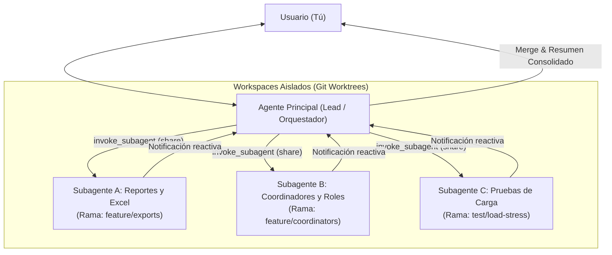

# Arquitectura y Guía: Múltiples Agentes con Worktrees en Antigravity

## 1. Respuesta Directa: ¿Es posible?

**Sí, 100% posible y es una de las capacidades más potentes de Antigravity.**

Desde esta misma conversación, el agente principal (yo) puede invocar y coordinar **múltiples subagentes en paralelo**, y cada uno puede trabajar en su propio espacio de trabajo aislado mediante **Git Worktrees** (`Workspace: 'share'`).

---

## 2. Cómo funciona el aislamiento de Workspaces en Antigravity

Al invocar un subagente con la herramienta `invoke_subagent`, se puede especificar el parámetro `Workspace`:

| Modo de Workspace | Mecanismo subyacente | Caso de uso ideal |
|---|---|---|
| `'share'` | **Git Worktree** (comparte el `.git` del repo sin duplicar almacenamiento en disco) | Agentes paralelos trabajando en ramas independientes sin colisionar con tu código actual. |
| `'branch'` | Clona / bifurca un workspace completamente aislado | Experimentos destructivos o pruebas de concepto independientes. |
| `'inherit'` *(por defecto)* | Comparte el mismo directorio de trabajo de esta conversación | Tareas secuenciales donde el agente colabora en los mismos archivos. |

---

## 3. Arquitectura del Flujo Multi-Agente



---

## 4. Capacidades y Herramientas del Sistema Multi-Agente

1. **Definición de Roles Especializados (`define_subagent`)**:
   - Se pueden crear tipos de agentes a medida con prompts de sistema específicos (ej. *Frontend Designer*, *Security Auditor*, *DB Optimizer*).
   - Se controlan sus permisos (solo lectura, herramientas de escritura, acceso a comandos, etc.).

2. **Ejecución Paralela No Bloqueante (Despertar Reactivo)**:
   - Cuando se lanzan varios subagentes, estos corren en segundo plano simultáneamente.
   - No hay consumo inútil de recursos esperando: el sistema despierta automáticamente cuando un subagente envía un mensaje o termina su trabajo.

3. **Mensajería Inter-Agente (`send_message`)**:
   - El agente principal puede darle retroalimentación, corregir tareas o coordinar entregables entre agentes.

4. **Gestión del Ciclo de Vida (`manage_subagents`)**:
   - Listar agentes activos (`list`), consultar su estado o destruirlos (`kill` / `kill_all`).

---

## 5. El Comando Slash `/teamwork`

En la interfaz de chat puedes escribir el comando:
```text
/teamwork
```
Este comando está diseñado para proyectos que se benefician de un equipo de agentes autónomos trabajando de forma coordinada en distintos aspectos de una gran funcionalidad.

---

## 6. Ejemplo Práctico para `bandera-asistencia`

Si deseas desarrollar dos módulos grandes al mismo tiempo:
1. **Agente 1 (Worktree A - `feature/export-excel`)**:
   - Implementa exportación en vivo a CSV y formato compatible con Excel de la lista de asistentes con timestamp, DNI y coordenadas.
2. **Agente 2 (Worktree B - `feature/staff-management`)**:
   - Implementa la vista administrativa para crear usuarios coordinadores (`STAFF`) y asignarles eventos específicos.

Ambos agentes trabajan a máxima velocidad sin pisarse los archivos ni bloquear el servidor de desarrollo, y luego el agente principal consolida y fusiona los cambios.
