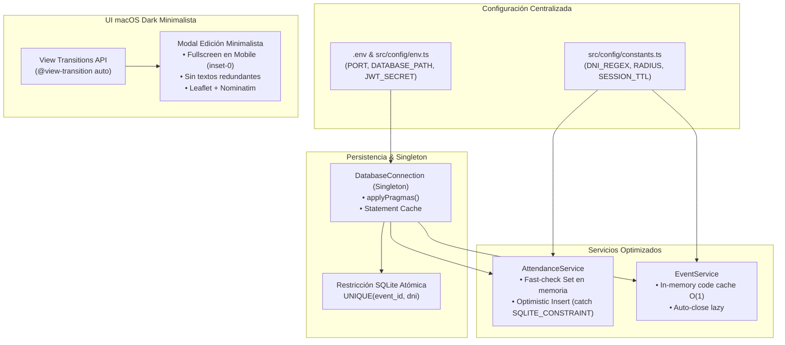

# Plan de Implementación: Singleton de Base de Datos, Optimización Atómica de Duplicados, View Transitions y Modal de Edición Minimalista Fullscreen

## 1. Descripción del Objetivo

El usuario solicita 4 mejoras arquitectónicas y de experiencia de usuario:
1. **Patrón Singleton Formal para la Base de Datos**:
   - Crear una clase formal `DatabaseConnection` Singleton para gestionar la conexión SQLite en Bun.
   - Aislar la configuración de sentencias `PRAGMA` (`WAL`, `foreign_keys`, `busy_timeout`) fuera de la lógica principal.
   - Implementar un diccionario de **Prepared Statements Cacheados** para evitar recompilar bytecode SQL en cada consulta.
2. **Manejo Atómico e Inteligente de Duplicados (Optimistic Insert)**:
   - Eliminar la consulta `SELECT` previa a la inserción en `AttendanceService.register`.
   - Ejecutar la inserción atómicamente y dejar que la restricción nativa `UNIQUE(event_id, dni)` de SQLite la valide, capturando `SQLITE_CONSTRAINT_UNIQUE` y mapeándola a `AttendanceAlreadyRegisteredError`.
   - Complementar con un `Set<string>` en memoria para descartar reintentos en nanosegundos sin tocar SQLite.
3. **Modal de Edición de Eventos Minimalista y Fullscreen en Mobile**:
   - Rediseñar el modal/vista de edición para eliminar todo texto redundante o sobreexplicativo, logrando una estética macOS Dark sobria y limpia.
   - En pantallas móviles (`sm:hidden` o breakpoint móvil), el modal debe ocupar **el 100% de la pantalla** (`fixed inset-0 w-full h-full rounded-none`), aprovechando todo el viewport.
4. **View Transitions API**:
   - Integrar la API nativa de navegadores **View Transitions** (`<meta name="view-transition" content="same-origin" />` y estilos `@view-transition`) para que las navegaciones entre páginas y transiciones de modales sean fluidas, instantáneas y sin parpadeos blancos.
5. **Centralización de Configuración y Variables de Entorno (`.env`)**:
   - Crear `.env.example` y `.env`.
   - Centralizar constantes de dominio (`EARTH_RADIUS_METERS`, `DNI_REGEX`, `DEFAULT_RADIUS_METERS`, etc.) en `src/config/constants.ts`.
   - Centralizar variables de entorno en `src/config/env.ts`.

---

## 2. Diagrama de Arquitectura



---

## 3. Plan de Cambios Detallado

### A. Configuración y Constantes (`src/config/`)

#### [NEW] `.env.example`
- Plantilla con documentación de:
  - `PORT=3000`
  - `NODE_ENV=development`
  - `DATABASE_PATH=data.sqlite`
  - `JWT_SECRET=tu-clave-secreta-de-produccion-min-32-chars`
  - `SESSION_COOKIE_NAME=auth_session`
  - `SESSION_MAX_AGE_SECONDS=28800`
  - `NOMINATIM_USER_AGENT=BanderaAsistencia/1.0 (asistencia@bandera.pe)`
  - `AUTO_SEED=false`

#### [NEW] `src/config/env.ts`
- Módulo tipado que lee `process.env` con validaciones y valores por defecto seguros.

#### [NEW] `src/config/constants.ts`
- Constantes de negocio:
  - `DNI_LENGTH = 8`
  - `DNI_REGEX = /^\d{8}$/`
  - `EARTH_RADIUS_METERS = 6_371_000`
  - `DEFAULT_RADIUS_METERS = 100`
  - `MIN_RADIUS_METERS = 10`
  - `MAX_RADIUS_METERS = 5000`
  - `SUPER_ADMIN_IDENTIFIER = "00000000"`
  - `DEFAULT_PAGE_LIMIT = 25`
  - `MIN_PASSWORD_LENGTH = 6`
  - `MIN_FULL_NAME_LENGTH = 3`
  - `EVENT_CODE_PREFIX = "ev-"`

#### [NEW] `src/config/index.ts`
- Exportación unificada de `env` y `constants`.

---

### B. Singleton de Conexión a Base de Datos (`src/db/`)

#### [MODIFY] `src/db/index.ts`
- Implementar la clase `DatabaseConnection`:
  ```typescript
  export class DatabaseConnection {
    private static instance: Database | null = null;
    private static statementCache = new Map<string, any>();

    public static getInstance(dbPath: string = env.DATABASE_PATH): Database {
      if (this.instance) return this.instance;

      const targetDir = dirname(dbPath);
      if (targetDir && targetDir !== ".") {
        mkdirSync(targetDir, { recursive: true });
      }

      const db = new Database(dbPath, { create: true });
      this.applyPragmas(db);
      this.instance = db;
      return db;
    }

    private static applyPragmas(db: Database): void {
      db.run("PRAGMA foreign_keys = ON;");
      db.run("PRAGMA journal_mode = WAL;");
      db.run("PRAGMA synchronous = NORMAL;");
      db.run("PRAGMA busy_timeout = 5000;");
    }

    public static prepare(sql: string): any {
      const db = this.getInstance();
      let stmt = this.statementCache.get(sql);
      if (!stmt) {
        stmt = db.prepare(sql);
        this.statementCache.set(sql, stmt);
      }
      return stmt;
    }

    public static setInstance(db: Database | null): void {
      this.instance = db;
      this.statementCache.clear();
    }

    public static close(): void {
      if (this.instance) {
        this.instance.close();
        this.instance = null;
        this.statementCache.clear();
      }
    }
  }
  ```
- Mantener funciones retrocompatibles: `getDatabase`, `setDatabase`, `closeDatabase`.

---

### C. Inserción Atómica y Detección de Duplicados (`src/services/`)

#### [MODIFY] `src/services/attendance.service.ts`
- **Eliminar el `SELECT` previo**:
  ```typescript
  // ANTES:
  const existing = db.prepare("SELECT id FROM attendances WHERE event_id = $event_id AND dni = $dni").get(...);
  if (existing) throw new AttendanceAlreadyRegisteredError(dni);
  ```
- **Reemplazar por Inserción Atómica**:
  ```typescript
  // AHORA:
  const memoryKey = `${event.id}:${dni}`;
  if (this.registeredKeys.has(memoryKey)) {
    throw new AttendanceAlreadyRegisteredError(dni);
  }

  try {
    const result = insertStmt.get(...) as { id: number; created_at: string };
    this.registeredKeys.add(memoryKey);
    return { ... };
  } catch (err: any) {
    if (
      err?.message?.includes("UNIQUE constraint failed") ||
      err?.code === "SQLITE_CONSTRAINT_UNIQUE" ||
      err?.code === "SQLITE_CONSTRAINT"
    ) {
      this.registeredKeys.add(memoryKey);
      throw new AttendanceAlreadyRegisteredError(dni);
    }
    throw err;
  }
  ```
- Importar `EARTH_RADIUS_METERS`, `DNI_REGEX` y `DEFAULT_PAGE_LIMIT` desde `src/config`.

#### [MODIFY] `src/services/event.service.ts` & `src/services/user.service.ts` & `src/utils/auth.ts`
- Sustituir todas las variables mágicas por las constantes de `src/config`.

---

### D. Modal de Edición Minimalista y Fullscreen en Mobile (`src/views/`)

#### [MODIFY] `src/views/admin/event_edit_view.tsx`
- **Limpieza de Texto Sobreexplicativo**:
  - Eliminar párrafos y subtítulos largos redundantes.
  - Dejar únicamente labels limpios y concisos (`Título *`, `Sede *`, `Ubicación GPS`, `Radio`, `Horario`, `Estado`).
- **Comportamiento Fullscreen en Mobile**:
  - En móvil: contenedor con clases `fixed inset-0 w-full h-full z-50 bg-neutral-950 p-4 overflow-y-auto rounded-none border-none`.
  - En desktop: contenedor centrado `max-w-3xl rounded-2xl border border-neutral-800`.
- **Integración en Dashboard**:
  - En `DashboardView`, permitir que el botón de editar abra el modal dinámicamente con View Transition o navegue directamente a la vista fullscreen.

#### [MODIFY] `src/views/layouts/admin_layout.tsx` & `src/views/asistencia.tsx`
- **View Transitions API**:
  - Agregar `<meta name="view-transition" content="same-origin" />` en el `<head>`.
  - Agregar estilos CSS `@view-transition { navigation: auto; }` y animaciones suaves para que los cambios de página y apertura de modales ocurran de forma natural y sin saltos visuales.

---

## 4. Plan de Verificación

### Pruebas Automatizadas
1. **Prueba de Inserción Atómica de Duplicados**:
   - `tests/attendance.test.ts`: verificar que el intento de registrar el mismo DNI dos veces en el mismo evento lance `AttendanceAlreadyRegisteredError` (409 Conflict) mediante la restricción UNIQUE de SQLite sin ningún `SELECT` previo.
2. **Prueba de Singleton de Base de Datos**:
   - Crear `tests/db_singleton.test.ts`:
     - Comprobar que `DatabaseConnection.getInstance()` devuelve la misma instancia.
     - Comprobar que `DatabaseConnection.prepare()` cachea los statements compilados.
     - Comprobar que `DatabaseConnection.setInstance()` reinicia el cache correctamente para testing.
3. **Prueba de Variables de Entorno y Constantes**:
   - Crear `tests/config.test.ts` verificando que los valores por defecto y las constantes numéricas/regex sean correctos.
4. **Verificación Global**:
   - `bun run typecheck` (0 errores en TypeScript).
   - `bun test` (100% de tests aprobados).

### Verificación Manual
1. Abrir el modal de edición de evento en pantalla de celular (o emulación responsiva de navegador):
   - Verificar que ocupa toda la pantalla (`w-full h-full inset-0`) sin desbordes.
   - Verificar la ausencia de textos largos o explicaciones obvias.
   - Probar la fluidez de navegación con la View Transitions API.
2. Registrar una asistencia:
   - Presionar "Enviar" dos veces rápido o simular concurrencia: comprobar que el sistema bloquea el duplicado instantáneamente.
