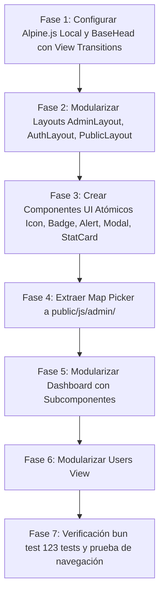

# Plan de Arquitectura de Vistas en Hono JSX: De Motor de Plantillas a Componentes Modernos

## 1. El Problema Actual: ¿Por qué Hono JSX se siente caótico ahora?

Actualmente, las vistas del proyecto parecen difíciles de estructurar y mantener debido a tres factores clave:

1. **Layouts y Vistas monolíticas gigantescas**:
   - `admin_layout.tsx` tiene **394 líneas** y duplica el menú de navegación, perfil de usuario y botones de logout tanto en la versión móvil como en la de escritorio.
   - `dashboard_view.tsx` tiene **1,208 líneas**.
   - `users_view.tsx` tiene **960 líneas**.
   - No hay un `auth_layout.tsx` ni un `public_layout.tsx` compartido; `login_view.tsx` y `welcome_view.tsx` reimplementan etiquetas `<html>`, `<head>`, fuentes y estilos.
2. **Scripts cliente embebidos como cadenas de texto**:
   - En `dashboard_view.tsx`, hay más de **180 líneas de JavaScript puro** dentro de un `<script dangerouslySetInnerHTML={{ __html: \`...\` }} />`. Esto elimina el autocompletado, la validación de errores y contamina la vista del servidor.
3. **Falta de transiciones fluidas unificadas**:
   - Las transiciones de página (View Transitions API) están puestas de forma dispar o faltan en vistas como login.

---

## 2. Equivalencia: Motores de Plantillas vs. Hono JSX

Si vienes de motores de plantillas como **Laravel Blade**, **EJS**, **Nunjucks**, **Handlebars** o **Jinja/Twig**:

| Concepto en Motor Tradicional (Blade / EJS / PHP) | Cómo se hace en Hono JSX (TypeScript) | Ventaja de Hono JSX |
| :--- | :--- | :--- |
| `@extends('layouts.admin')` / `<%- include('layout') %>` | `<AdminLayout title="...">{children}</AdminLayout>` | Tipado estricto en props, autocompletado total. |
| `@include('layouts.sidebar')` | `<AdminSidebar activePath={...} />` | Reutilización limpia sin duplicar código móvil/desktop. |
| `@include('partials.stats')` | `<StatCard title="Total" value={10} icon="users" />` | Función pura TS reutilizable en cualquier vista. |
| `<x-badge color="green">` / Componentes UI | `<Badge variant="open">Abierto</Badge>` | Reutilizable y componible como shadcn/ui. |
| `@push('scripts')` | `<script src="/js/admin/dashboard.js" defer></script>` | Scripts ordenados en archivos `.js` reales con linting. |
| `{{ $variable }}` (escapado seguro) | `{variable}` | Protegido contra inyecciones XSS nativamente por Hono. |
| `@viewTransition` (Laravel / Turbo / MPA) | `<meta name="view-transition" content="same-origin" />` | Navegación instantánea fluida tipo SPA entre páginas MPA. |

---

## 3. Estrategia de Transiciones: Como en PHP / Laravel

Implementamos dos niveles de transiciones:

### Nivel 1: Transiciones entre Páginas (Cross-Document View Transitions)
Igual que en frameworks modernos de PHP (Laravel con Livewire/Turbo/Swup o MPA View Transitions nativo de Chrome/Edge/Safari):
- Al hacer clic en un enlace de navegación (`/admin` -> `/admin/attendances` -> `/admin/users`), el navegador no da un pantallazo en blanco.
- El contenido anterior hace un sutil fade-out y el nuevo hace un fade-in suave (`150ms`).
- Se define en un componente compartido `<BaseHead />` para que **todas** las vistas (Admin, Pública, Login, Asistencia) tengan transiciones automáticas sin configuraciones complejas.

```css
@view-transition {
  navigation: auto;
}

::view-transition-old(root) {
  animation: 90ms cubic-bezier(0.4, 0, 1, 1) both fade-out;
}
::view-transition-new(root) {
  animation: 180ms cubic-bezier(0, 0, 0.2, 1) 40ms both fade-in;
}

@keyframes fade-out {
  from { opacity: 1; transform: translateY(0); }
  to { opacity: 0; transform: translateY(-4px); }
}
@keyframes fade-in {
  from { opacity: 0; transform: translateY(4px); }
  to { opacity: 1; transform: translateY(0); }
}
```

### Nivel 2: Transiciones dentro de la Página (Alpine.js)
Para elementos que cambian en tiempo real sin recargar la página:
- Modales que abren con animación suave (`scale` + `fade`).
- Filtros de tarjetas y filas que aparecen/desaparecen suavemente.
- Notificaciones de alerta que se cierran con transición.

---

## 4. Arquitectura Modular de Directorios

Organizamos las vistas siguiendo el patrón **Component-Driven View Architecture**:

```
src/views/
├── layouts/                     # Esqueletos HTML modulares
│   ├── base_head.tsx            # <head> común (meta, fuentes, tailwind, view-transitions, alpine)
│   ├── admin_layout.tsx         # Layout Admin simplificado (~40 líneas)
│   ├── public_layout.tsx        # Layout Público para Asistencia y Welcome
│   ├── auth_layout.tsx          # Layout para Login y Pantallas de Acceso
│   └── components/              # Subpiezas del Layout (evita duplicidad)
│       ├── admin_sidebar.tsx    # Sidebar de escritorio permanente
│       ├── admin_mobile_nav.tsx # Header móvil y cajón deslizante
│       ├── nav_item.tsx         # Ítem de navegación individual reutilizable
│       └── user_profile_box.tsx # Tarjeta de sesión de usuario y botón logout
│
├── components/                  # Componentes reutilizables globales (Atoms / Molecules)
│   ├── ui/                      # Elementos base (estilo shadcn/ui)
│   │   ├── icon.tsx             # <Icon name="calendar" class="..." /> (unifica SVGs)
│   │   ├── badge.tsx            # <Badge variant="open">Abierto</Badge>
│   │   ├── button.tsx           # <Button variant="primary">...</Button>
│   │   ├── modal.tsx            # <Modal id="myModal" title="..." openVar="openModal">...</Modal>
│   │   ├── alert.tsx            # <Alert type="success" message="..." />
│   │   └── page_header.tsx      # Cabecera estándar de página (título, descripción, acciones)
│   └── stat_card.tsx            # <StatCard title="Eventos" value={10} icon="calendar" />
│
├── admin/                       # Páginas del panel de administración
│   ├── dashboard/               # Módulo Dashboard
│   │   ├── dashboard_view.tsx   # Orquestador (~120 líneas vs 1,208)
│   │   └── components/          # Subcomponentes exclusivos del dashboard
│   │       ├── event_card.tsx
│   │       ├── event_table.tsx
│   │       ├── filter_toolbar.tsx
│   │       └── quick_create_modal.tsx
│   ├── users/                   # Módulo Usuarios / Coordinadores
│   │   ├── users_view.tsx
│   │   └── components/
│   │       ├── user_modal.tsx
│   │       └── user_table.tsx
│   ├── attendances_view.tsx
│   └── event_detail_view.tsx
│
public/
├── js/
│   ├── vendor/
│   │   └── alpine.min.js        # Alpine.js local (15KB, sin CDN, funciona offline)
│   ├── admin/
│   │   ├── dashboard-filter.js  # Lógica reactiva de filtros y búsqueda
│   │   └── map-picker.js        # Leaflet map picker reutilizable
│   └── asistencia.js            # Lógica pública existente
```

---

## 5. Ejemplos de Implementación Modular

### 1. `BaseHead`: Transiciones y Alpine centralizados
```tsx
// src/views/layouts/base_head.tsx
export function BaseHead({ title }: { title: string }) {
  return (
    <head>
      <meta charset="UTF-8" />
      <meta name="viewport" content="width=device-width, initial-scale=1.0, maximum-scale=1.0, user-scalable=no" />
      <meta name="view-transition" content="same-origin" />
      <title>{title} — Asistencia</title>
      <link rel="preconnect" href="https://fonts.googleapis.com" />
      <link rel="preconnect" href="https://fonts.gstatic.com" crossOrigin="anonymous" />
      <link href="https://fonts.googleapis.com/css2?family=Inter:wght@400;500;600;700&display=swap" rel="stylesheet" />
      <link rel="stylesheet" href="/css/tailwind.css" />
      <script src="/js/vendor/alpine.min.js" defer></script>
      <style>{`
        @view-transition { navigation: auto; }
        ::view-transition-old(root) { animation: 90ms cubic-bezier(0.4, 0, 1, 1) both fade-out; }
        ::view-transition-new(root) { animation: 180ms cubic-bezier(0, 0, 0.2, 1) 40ms both fade-in; }
        @keyframes fade-out { from { opacity: 1; transform: translateY(0); } to { opacity: 0; transform: translateY(-4px); } }
        @keyframes fade-in { from { opacity: 0; transform: translateY(4px); } to { opacity: 1; transform: translateY(0); } }
        [x-cloak] { display: none !important; }
        body { font-family: 'Inter', -apple-system, sans-serif; -webkit-font-smoothing: antialiased; }
      `}</style>
    </head>
  );
}
```

### 2. `AdminLayout`: Limpio y desacoplado
```tsx
// src/views/layouts/admin_layout.tsx
import { BaseHead } from "./base_head";
import { AdminSidebar } from "./components/admin_sidebar";
import { AdminMobileNav } from "./components/admin_mobile_nav";

export function AdminLayout({ title, user, activePath = "/admin", children }: AdminLayoutProps) {
  return (
    <html lang="es" class="h-full bg-neutral-950">
      <BaseHead title={`${title} — Panel de Gestión`} />
      <body class="min-h-full bg-neutral-950 text-slate-100 antialiased flex flex-col md:flex-row">
        <AdminMobileNav user={user} activePath={activePath} />
        <AdminSidebar user={user} activePath={activePath} />
        
        <main class="flex-1 md:pl-64 min-w-0">
          <div class="max-w-7xl mx-auto p-4 sm:p-6 lg:p-8">
            {children}
          </div>
        </main>
      </body>
    </html>
  );
}
```

---

## 6. Plan de Implementación por Fases



### Fase 1: BaseHead, Alpine.js Local y View Transitions
- Descargar o crear `public/js/vendor/alpine.min.js`.
- Crear `src/views/layouts/base_head.tsx` con estilos de View Transitions unificados y `[x-cloak]`.

### Fase 2: Descomposición de Layouts
- Crear `src/views/layouts/components/nav_item.tsx`, `admin_sidebar.tsx`, `admin_mobile_nav.tsx`, `user_profile_box.tsx`.
- Reducir `src/views/layouts/admin_layout.tsx` a un wrapper limpio de ~40 líneas.
- Crear `src/views/layouts/auth_layout.tsx` para `login_view.tsx`.
- Crear `src/views/layouts/public_layout.tsx` para `welcome_view.tsx` y `asistencia.tsx`.

### Fase 3: Componentes Atómicos UI
- Crear `src/views/components/ui/`:
  - `icon.tsx` (unifica todos los SVGs del proyecto en un solo componente `<Icon name="..." />`).
  - `badge.tsx` (estados unificados con variantes: open, closed, admin, staff).
  - `alert.tsx` (notificaciones info, éxito, error).
  - `modal.tsx` (modal accesible con Alpine: `x-show`, fade-in suave, cierre por click exterior y tecla Escape).
  - `stat_card.tsx` (tarjeta de métricas).

### Fase 4: Map Picker Reutilizable
- Mover Leaflet + Geocoding OSM a `public/js/admin/map-picker.js`.

### Fase 5: Refactorización de Dashboard
- Crear `src/views/admin/dashboard/` con `components/` (`event_card.tsx`, `event_table.tsx`, `filter_toolbar.tsx`, `quick_create_modal.tsx`).
- Reducir `dashboard_view.tsx` de 1,208 a ~120 líneas.

### Fase 6: Refactorización de Users View
- Reducir `users_view.tsx` de 960 líneas a ~120 líneas usando `<Modal>` e `<Icon>`.

### Fase 7: Verificación Total
- Ejecutar `bun test` asegurando que los 123 tests sigan pasando al 100%.
- Probar navegación fluida entre páginas observando las transiciones automáticas.
